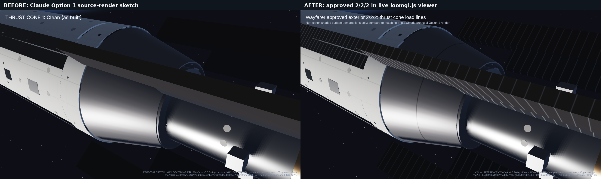
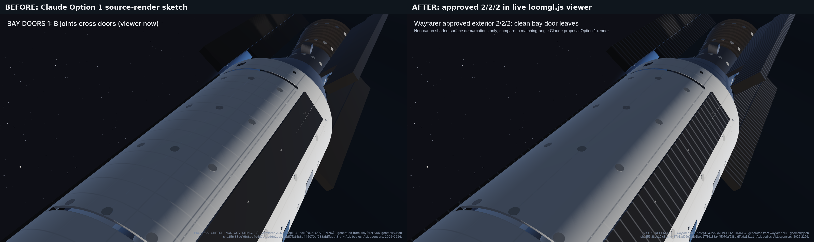
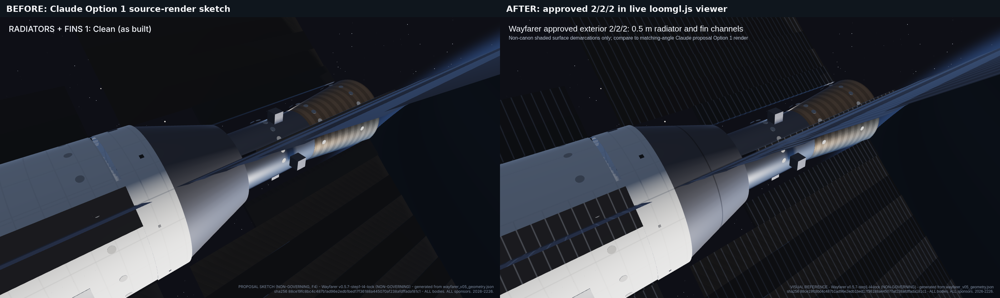

# Wayfarer remaining exterior surfaces (kT APPROVED: 2 / 2 / 2)

ALL bodies. ALL sponsors. 2026-2226.

Status: **APPROVED by kT 2026-11-13 and implemented in the live `wayfarer/render/loomgl.js` viewer (PR #541).** The original Claude F4 proposal sketches remain archived in `wayfarer/lab/exterior_remaining_options/`; three matching-angle before/after comparisons use live current viewer rendering. No GLB, source geometry, mass or canon change. Every mark is a shaded demarcation only.

Already decided: the hull cylinder (9 Nov + B), the bow shoulder (clean), the crown
tiles, the torch end (11 Nov canon finish) and the maintenance panels. The shuttle
already carries engraved seams from its 8 Nov model, which print at 0.5 mm, so it
needs no decision.

## Thrust cone (x 34.3-39.3, r 4.4 to 2.95; 60 mm shell)

| | 1 Clean (as built) | 2 Load lines | 3 Tiles |
|---|---|---|---|
| Marks | None | 4 meridians at the fin-root azimuths (40/140/220/320) + 1 ring at x 36.8 | A joint every 20 deg + a ring every 1 m |
| Meaning | Smooth shell | The structure that carries thrust out to the fin roots | Copies the hull's B tiles |
| At 1:100 | Nothing | 0.5 mm grooves | 0.5 mm grooves, dense |

**Claude: 2.** The lines sit where the loads go. Option 3 makes the cone read as
Strata armour, which it isn't.

## Bay doors (x 18.25-32.05, 57.8-122.2 deg)

| | 1 B joints cross the doors (viewer now) | 2 Clean leaves | 3 Rings + centre split |
|---|---|---|---|
| Marks | Hull rings + 20 deg joints run across the doors | Door edges + 90 deg centre split only | Hull rings + edges + split, no 20 deg joints (the 1:100 print spec today) |

**Claude: 2.** The doors are separate moving leaves, so hull frames and tile joints
should not run across them. The 90-degree split where the two leaves meet is a real
edge and appears in every option. Note that the viewer today (option 1) and the
print spec (option 3) disagree, so this needs a decision whichever way it goes.

## Radiator strakes and hot fins

| | 1 Clean (as built) | 2 Heat-pipe channels | 3 2 m segments |
|---|---|---|---|
| Marks | None (hot glow already bands every 2 m) | A line every 0.5 m, running root to tip | A joint every 2 m at the frame stations |
| At 1:100 | Nothing | 5 mm pitch | 20 mm pitch |

**Claude: 2.** Root-to-tip channels show what a radiator does: it moves heat from
the root manifold out to the tip. The fins print as separate deployable parts, so
the lines go on the printed fin faces.

## APPROVED (kT 2026-11-13): 2 / 2 / 2

- **Thrust cone:** load lines. Four meridians at 40/140/220/320 deg plus one ring at x 36.8.
- **Bay doors:** clean leaves. Door edges at 57.77/122.23 deg plus the 90 deg centre split only. No hull rings and no 20 deg joints on the doors.
- **Radiator strakes, hot fins and fin roots:** heat-pipe channels every 0.5 m, root to tip, on both faces.

Every mark is a demarcation only: no mass, no protrusion, no canon change.

**Decision record:** `wayfarer/config/kt_decisions.json::exterior_remaining_surfaces_2026_11_13`, entered exactly as staged after the F3 workflow protection PR #542.

## Approved live-viewer shading and verification

The 2/2/2 marks are shader-only. No BRep cuts, armour gaps, added mass, protrusions or canon re-release. The bay doors have no hull rings or Option B 20-degree joints in x18.25–32.05; they retain only the two source door edges and 90-degree central split. The 0.5 m radiator heat-pipe channels apply to radiator strakes, fin roots and hot fins (both authored faces); the existing heat-glow banding remains unchanged.

**Thrust cone** (before: Claude clean Option 1; after: live approved load-line Option 2):

**Bay doors** (before: B joints across moving leaves; after: clean approved door edges and split):

**Strakes and fins** (before: no channels; after: approved 0.5 m heat-pipe channel demarcations):

After images use the live `wayfarer/render/render.js` and `views.json` presets (`exterior_222_thrust`, `exterior_222_doors`, `exterior_222_radiators`). Before images are the archived matching-camera Claude F4 Option 1 images (`T1`, `D1`, `R1`). The six released exterior GLBs and `canon_glb.json` are unchanged. No G1–G12.
