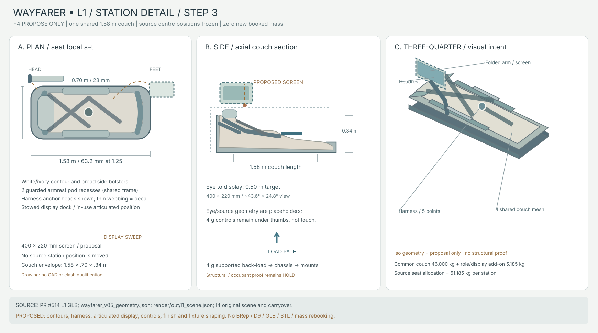

# WAYFARER L1 · STATION STEP 3 · F4 PROPOSAL ONLY
ALL bodies. ALL sponsors. 2026–2226. **Not approved for drawing/export.**

**Source anchor:** live `loom-2226/loom-2226`, main `0c375de0a1a2bdf65f7028bbccc664da62d9aa67`; PR #514 **approved L1 layout**, [independent L1 GLB](../render/out/interior_L1.glb), [D9/containment report](../render/out/interior_L1_report.json). `wayfarer/config/kt_decisions.json`: `wayfarer_l1_layout_approval_2026_11_12` and `interior_glb_build_rules_2026_11_12` remain unchanged. **F4 governs this *new station detailing*.** No BRep, mesh, D9, qualification, exterior change, GLB or STL in this PR.

## 1. Settled frame (not revisited)

All six station **centres**, approved source 1.58 m couches, Pilot/Captain terrace, Navigator platform, S4 current (Y=+2.40,Z=−1.70), both ladderways, pressure-assisted open leaves, and utilities/avionics-rack/goods-lift core remain unchanged. Source positions in `wayfarer/config/wayfarer_v05_inputs.json::habitat.decks[0].command_layout.i4_lock.stations`; current viewer source `wayfarer/render/out/l1_scene.json`. Trunk is **not egress**.

- **SOURCE couch dimension:** 1.58 m × 0.70 m; current shared mesh envelope locally extends ≈0.34 m axially. Both constrained seating surfaces and total span remain fixed.
- **SOURCE six seat mass bookings:** each `i4_seat_PILOT/NAV/S1/S2/S3/S4` = **51.185186564 kg** (source mass split already integrated, no extra dry mass).
- **SOURCE screen visual:** six 0.40 × 0.22 m surfaces from `l1_scene.json.displays`. Six distinct per-station screen **masses are not separately booked** in the geometry ledger. Prior viewer screens are illustrative, with current `l1_scene` eye-to-screen centre distance roughly 0.05 m, unusable as a literal display.
- **SOURCE:** Source `i4_*` fixtures are real booked *items* currently represented as simple blocks; the shapes below are all **PROPOSED**, not hidden additions.

## 2. Common contoured couch, 4 g operating intent

**PROPOSED** sculpted body-bearing surface inside **1.58 × 0.70 × 0.34 m** approved couch *solid* bounds: head/neck cradle (first ~0.24 m), shoulders/upper-back lateral support, shallow pelvic pocket, gently elevated thighs and positive foot cradle. Two recessed armrests run roughly station longitudinal s=0.35–1.10 m, total silhouette ≤0.70m wide. Five-point restrained posture: shoulder ×2, lap ×2, anti-submarine ×1 with flush buckle. Harness anchor points routed into same 46 kg common load-bearing frame; no mount protrusions or additional floor hardware authorised.

**4 g concept only:** crew are lying back, supported through head, shoulders, pelvis and thigh surfaces. Four g on a **100 kg illustrative occupant** means ≈**3.92 kN** inertial body load (4×9.81×100), to be reacted by couch/anchors/ship structure in the actual acceleration vector. Harness also deals with off-axis and adverse phases. Current evidence **does not** establish mount strength, load distribution, occupant variability, bone/soft tissue tolerance, pressure suit fit, or permitted duration. All six stations stay occupied in the source 4 g mode; low-g work areas are inactive. External *non-canon* precedent: [NASA active NASA-STD-3001 Vol. 2 Rev. F](https://standards.nasa.gov/node/237) on crew body supports and acceleration exposure. It does **not** qualify LOOM hardware.

**PROPOSED common physical representation**: one shared couch mesh with flush contour, headrest, base, broad armrests and visible anchor bosses, instanced six times. Webbing thinner than 15 mm at true-scale is represented with **decals** in 1:25 derivative, not thick bars or fake structural straps. Role differences are small instanced add-ons, never a new couch.

## 3. Display/console placement

Current `l1_scene.json` visual screen centres are only ~0.05 m from current viewer eye points. **PROPOSED in-use** screen centre ≈**0.50 m along −X from the viewer eye**, with screen normal aimed toward the eye. Existing I4 screen face width 0.40m, height 0.22m gives approx **43.6° horizontal × 24.8° vertical** viewing angle at 0.50m (flat screen, centred). Target optical axis within 10° of comfortable head-supported sightline; not yet anthropometrically tested. The eye points in `wayfarer_v05_inputs.json` are partly from older I4 concept and **must not override** the current `l1_scene.json` review eyes. The extra forward screen sweep is **PROPOSED within L1 cabin free volume**, **NOT** asserted to fit inside the previous source *proxy* screen AABB.

- **PROPOSED stowed:** the display and a two-link arm nest against an outer armrest or aft side of couch; occupies only the already allocated local couch station hardware. **Detailed swing path and cabin clash HOLD.**
- **PROPOSED in-use:** screen on a ≥25mm-diameter arm supported from couch, not dome/window; 0.50m eye distance, roughly aligned to couch centreline. No shared deployable floor console, no added deck mount. Bracket/base motion and screen occlusion remain HOLD.
- **PROPOSED at 4 g:** fine touch is not required; thumbs operate the guarded controls on armrests without reaching beyond braced position. Screen is readable, not a load-bearing restraint.

**Constraint alert, NOT demonstrated stop:** source stowed screen and in-use screen locations are different. The in-use display needs a swept free-space test **after approval** before calling the final station usable. No settled station position or source mass allocation needs changing in the sketch; nothing currently proves an impossible fit.

## 4. Exact booked seat budget (proposal partition, not changed ledger)

**No new mass and no double booking.** The following items are **PROPOSED internal splits** of each already-booked `i4_seat_<id>` **51.185186564 kg**, *not* separate authoritative item masses. No independent screen-owner ID has been identified; do not also book the screen under `outfit_L1`.

| Proposed part, one station | Proposed mass kg | Actual authority | Classification |
|---|---:|---|---|
| COMMON shared couch: frame/seat-base and mount | 15.000 | i4_seat_<id> PR #514; local couch frame | **PROPOSED internal split** |
| Contoured shell/pan, back and foot cradle | 9.000 | l1_interior_glb.py PANELS; I4 couch target | **PROPOSED refinement** |
| Headrest, lateral cradles | 3.000 | PR #514 head wings; I4 couch | **PROPOSED refinement** |
| Padding + soft contacting surfaces | 6.000 | PR #514 existing couch pans; material not separately approved | **PROPOSED** |
| Five-point harness and anchor hardware | 7.000 | I4 4g seated doctrine; physical harness not yet authored | **PROPOSED** |
| Two common armrests + grip rails | 4.000 | I4 command 4g couch + existing PR514 shape | **PROPOSED** |
| Base hardpoints, damping interfaces | 2.000 | existing I4 source 0.05t seating allowance; mount load HOLD | **PROPOSED** |
| Foldaway 400×220 mm display + bezel + jointed arm | 3.000 | render/out/l1_scene.json displays; source 0.4×.22 m | **PROPOSED internal split** |
| Role-specific armrest input modules (pair) | 2.185 | I4 six source roles; hardware not settled | **PROPOSED internal split** |
| **TOTAL** | **51.185** | One `i4_seat_<id>` source booking | **ZERO delta** |

The **common physical couch accounts for 46.000 kg**, instantiated six times, **role/control/display add-ons account for 5.185 kg per station**, and total for all six booked seat owners is **307.111 kg**. No load test has established a 46kg frame can survive a 4g mission. This is a *mass feasibility budget*, not structural certification.

## 5. Controls by booked station role

All controls are **PROPOSED** small left/right armrest inserts inside the 5.185kg seat-owner add-on allowance; no new source objects or power allocations. Visual identifiers and mode pages are decals/texture for printing, not geometry. Pilot and Captain both retain reachable flight controls. **No control authority or governance decision has been settled by this proposal.**

| Station | Proposed physical control difference | Proposed screen view | Provenance |
|---|---|---|---|
| PILOT | Flight control: thumb attitude stick + translation paddle | Read-only main flight, setpoint confirmation, handover prompt | PROPOSED modules; Pilot role SOURCE |
| S1 / Captain | Same flight sticks; command transfer / veto tab | Crew/mission overview and steering authority state | PROPOSED authority handling; Captain role SOURCE |
| NAV | Waypoint/trajectory jog dial + 2-axis cursor | Transfer solutions, uncertainty bands, next-burn review | PROPOSED controls; Navigation/Loom role SOURCE |
| S2 / Engineering | Thermal/power encoder + acknowledge pad | Reactor and ECLSS/thermal trend pages; guarded contingencies | PROPOSED controls; Engineering role SOURCE |
| S3 / Sensors/EW | Track-slew control + modality selector | Optical/RF sensor overlays, contacts and EW status | PROPOSED controls; Sensors/EW role SOURCE |
| S4 / Mission ops | Task-sequence dial + asset-select thumb pad | Courier/robotics/task status and tactical timeline | PROPOSED controls; Mission Ops role SOURCE |

## 6. Existing booked fixtures: replace their boxes with actual *shape families*

One map-table design family, one workbench design family, and one cabinet family; nested overlapping source allocations remain separately booked and **not counted twice**. Physical shaping ideas stay within the *existing source bounding boxes*, so this is not an invitation to relocate furniture:

- **PROPOSED map table:** soft-chamfered 1.10×0.63 m top, continuous tactile rim, recessed inset and visibly open under-top brace **inside the original 0.12 m axial envelope**; integrated map console from its **distinct 12 kg** source owner. The smaller `i4_mission_table` is nested within the big `i4_shared_map_table` source footprint; propose as the table's under-top solid cassette, **not** as an additional spatially competing table.
- **PROPOSED workbench:** low-radius 1.38×0.54 m work face, captive 25mm rim and 30mm bracing at underside, glove-friendly shallow inset; existing `i4_workbench` is a nested booked underside cassette inside `i4_equipment_workbench`; existing vertical `i4_workbench_display` gets a frame/bezel but the booked box and mount location remain unchanged.
- **PROPOSED cabinetry:** chamfered 0.54 m axial × 0.35 m Y × 0.70 m Z cases with flush two-leaf fronts and 20–25mm structural perimeter; `i4_engineering_cabinet` and `i4_sensors_cabinet` share their shape, distinct source owners; the overlapping `i4_cabinetry` becomes a contained internal case insert, **not** a new third freestanding cabinet. Seams and latch labels are decals, not tiny handles.

| Existing booked owner | Existing booked kg | Shape/source note | Status |
|---|---:|---|---|
| `i4_shared_map_table` | 95.000 | I4 carryover; main lip/tilted display frame; top 1.10×0.63 m | **PROPOSED** shape, existing booking |
| `i4_mission_table` | 81.896 | I4 original mass proxy nested inside shared map; secondary under-top cassette, no duplicate surface | **PROPOSED** shape, existing booking |
| `i4_equipment_workbench` | 90.000 | I4 carryover; recessed 1.38×0.54 m surface and low guard | **PROPOSED** shape, existing booking |
| `i4_workbench` | 81.896 | I4 proxy nested inside equipment bench; its booked lower cassette only | **PROPOSED** shape, existing booking |
| `i4_engineering_cabinet` | 80.000 | I4 carryover; bevelled 0.54×0.35×0.70m cabinet and two flush fronts | **PROPOSED** shape, existing booking |
| `i4_sensors_cabinet` | 80.000 | I4 carryover; same outer form, sensor role decal | **PROPOSED** shape, existing booking |
| `i4_cabinetry` | 40.948 | I4 proxy overlaps engineering case; internal cassette / shelf, no extra cabinet | **PROPOSED** shape, existing booking |
| `i4_workbench_display` | 30.000 | I4 carryover; 1.16×0.42 m low-profile bezel/display | **PROPOSED** shape, existing booking |
| `i4_map_console` | 12.000 | I4 carryover; 0.22×0.035m map interface face, decal graphics | **PROPOSED** shape, existing booking |
| `i4_low_g_command_point` | 28.000 | I4 carryover, unchanged; low-g only | **PROPOSED** shape, existing booking |

Additional unchanged source parts (not reshaped in this proposal): `i4_rails_0..3` **9 kg each**; `i4_lights_0..1` **4 kg each**; `i4_transfer_0..1` **22 kg each**; `i4_observation_rail_0..17` **1.388889 kg each** (25.000 kg total), `i4_terrace_column_0..3` **4.209771 kg each**. Source `floor_L1`, terrace, NAV platform, hatches, core, ladderways all stay unchanged. Exact source owner names/masses taken from `wayfarer/results/out/wayfarer_v05_geometry.json::parts`. Fixture IDs are not new purchases or extra dry weight.

## 7. Colour / 1:25 physical model guide

**PROPOSED finish**: open-light rather than near-black slate. Couch outer shell **#ACBBBD** (light blue-grey), pressure-contact cushions **#D8D8CD** (warm grey-ivory), frame **#607A84** (medium blue slate), harness **#50656C**, display surround **#B8C9C5**, controlled teal accents **#71999B**. Aim 10–20% lighter paint at print scale if colour wash obscures form. No physical surface or thermal qualification is claimed.

| Detail | True scale | 1:25 | Representation |
|---|---:|---:|---|
| Full contoured couch | 1580×700×340 mm | **63.2×28×13.6 mm** | Geometry |
| Cushion/headrest broad contour | ≥150 mm footprint | ≥6 mm | Geometry |
| Stowable screen face | 400×220 mm | **16×8.8 mm** | Geometry, blank face |
| Screen bezel and mechanical arm | 25mm min / 25mm dia | 1.0mm | Geometry; screen graphics DECAL |
| Structural harness anchor boss | ≥20mm | 0.8mm | Geometry; strap textile <15mm thick DECAL |
| Armrest body / palm control module | ~60mm minimum visible body | 2.4mm | Geometry; keys/switch marks DECAL |
| Map table primary top | 1100×630 mm | **44×25.2 mm** | Geometry, text/grid decal |
| Workbench main surface | 1380×540 mm | **55.2×21.6 mm** | Geometry; ruler marks decals |
| Cabinet external case | 540×350×700 mm | **21.6×14×28 mm** | Geometry; labels/latches DECAL |
| Subpanel seams, switch faces, LED dots | <15mm source relief | <0.6mm | **DECAL / paint ONLY** |

**Hard print rule:** nothing new under **0.6 mm** at 1:25 as freestanding or relief geometry (i.e. 15mm at ship true scale); thin textile harnesses, labels, buttons, slot markings, screen UI and warnings are decals. No STL derivation attempted.

## 8. Release boundary / non-demonstrated requirements

**F4 PROPOSE ONLY.** No changes to `kt_decisions.json`, `interior_L1.glb`, six exterior GLBs, dry 868.1922552640087 t, ECON 707.845 km/s, stations, floors or hatch locations. This proposal does **not** prove 4g anchor loads, body fit, suited reach, spatial screen swing clearances, or actual in-use panel occlusion. No source evidence establishes a fatal clash or mass overrun at this stage; therefore **no STOP conflict picture is required**. kT must approve this new station detail before any BRep/D9/export.

Source references: `wayfarer/config/kt_decisions.json`; `wayfarer/config/wayfarer_v05_inputs.json`; `wayfarer/results/out/wayfarer_v05_geometry.json`; `wayfarer/render/out/l1_scene.json`; `wayfarer/lab/l1_interior_glb.py`; `wayfarer/docs/I4_ORIGINAL_SCENE_2026_10_29.json`; `wayfarer/docs/I4_SOURCE_IMPLEMENTATION_BRIEF_2026_10_29.md`; `wayfarer/docs/I4_COMPLETENESS_RECOVERY_2026_11_01.md`.
