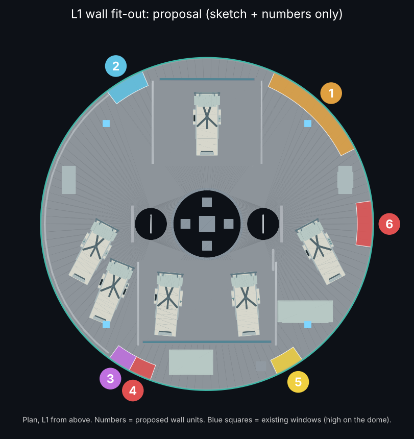
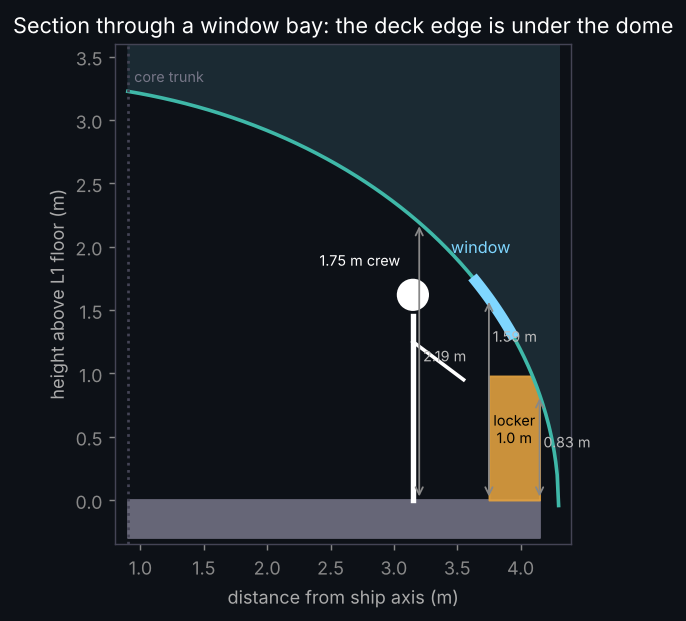
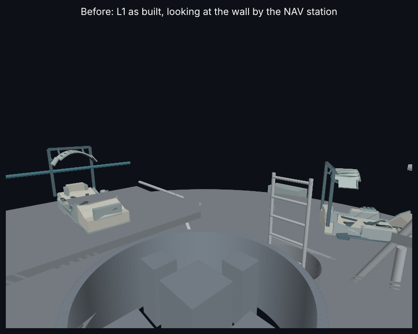
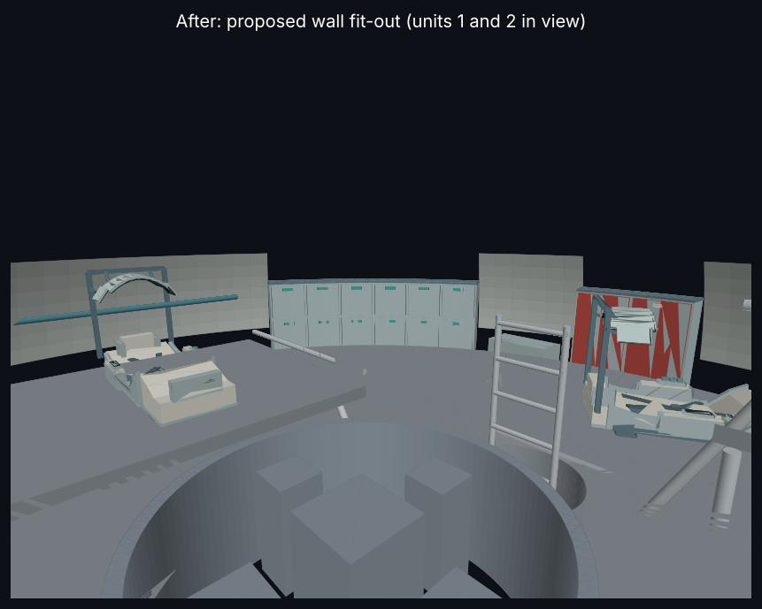

# Wayfarer L1 wall fit-out: proposal (12 Nov 2026)
**ALL bodies. ALL sponsors. 2026-2226.**

**Status:** kT APPROVED the concept and the modelling on 12 Nov 2026. Claude designed it. **Not built.** This is a rule F4 proposal package: sketch plus numbers. Canon, BRep, mass and the exterior are unchanged. D9 has not been run.

## Why
L1 (PR #518) reads empty. About 2.97 t is booked on L1 but not drawn: `room_L1-command` 2.150 t plus `outfit_L1` 0.819 t. kT's direction: Claude designs the furniture, starting from diagrams, and every item has a purpose. The floor stays open for 4 g egress and zero-g movement.

## Key constraint: the deck edge sits under the dome
Using the source pressure vessel (outer) `X_shell(r) = 3.0431182268 − 3.3431182268·√(1−(r/4.30)²)` and the floor top at X = 3.00, the headroom is **0.83 m at r = 4.15**, 1.59 m at r = 3.75 and 2.19 m at r = 3.20. There is no full-height wall, so every unit is a low cabinet: **h 0–0.95 m, r 3.755–4.00 m**, below the windows (h ≈ 1.49–1.79 m).

## Units
Frame: glTF = [X, Z, −Y]. The plan angle `a` is measured from −Y toward +Z, and h is the height above the L1 floor top.

| # | Node | Purpose | Plan angle | Est. mass |
|---|---|---|---|---:|
| 1 | `proposal:u1_spares_tools` | Spare halo screens and armrest controls to swap in flight, plus the deck tool kit. 12 latched doors in 2 rows | 27–66° | 96 kg |
| 2 | `proposal:u2_watch_galley` | Hot/cold water and food pouches for long watches and burns. Water piped from the L2 galley | 113–126° | 52 kg |
| 3 | `proposal:u3_courier_strongbox` | Locked safe for the physical secure messages Wayfarer carries as a courier. Captain controls it | 234–242° | 60 kg |
| 4 | `proposal:u4_emergency_left` | Fire extinguisher, breathing masks, medical kit with defibrillator | 242–250° | 40 kg |
| 5 | `proposal:u5_backup_panel` | Hard-wired alarms, breakers, and fire/depress controls that work if every screen fails. Next to the low-g command point | 295–305° | 30 kg |
| 6 | `proposal:u6_emergency_right` | As unit 4, by the other ladderway | 354–10° | 40 kg |
| 7 | `proposal:u7_wall_lining` | Padding against knocks in zero g, plus acoustic and thermal lining. Follows the dome 0.06 m inboard, h 0.30–1.30, only between units, below the windows | free arcs | 40 kg |
| | | **Total** | | **358 kg** |

**Mass:** all 358 kg comes from the existing `outfit_L1` booking (0.819 t). The remaining ~461 kg stays as distributed cabling, ducts and fire detection, which is not drawn. The `room_L1-command` 2.150 t is not touched. Its intended content is **OPEN** (Sol to state it). **No rebooking:** dry mass 868.1922552640087 t and ECON Δv 707.845 km/s are unchanged.

**Palette:** the B3 palette (light blue-grey shell #ACBBBD, slate #607A84, teal #3FA79A, ivory #D8D8CD) plus emergency red #B5473F, panel yellow #E3B23C and a vault grey.

## Screens done by Claude (not D9)
- **Containment:** every vertex is at least 0.030 m inside the inner shell (outer profile minus 30 mm).
- **Existing parts:** no vertex of any existing L1 interior part (PR #518 GLB, room/outfit/floor excluded) lies inside a unit volume. The lining stays at least 0.13 m from the observation rail.
- **Tightest gaps:** unit 6 to the Engineering couch foot ≈ 0.04 m; unit 2 to the observation rail ≈ 0.03 m; unit 1 to the engineering cabinet ≈ 0.20 m.

## Print at 1:25
Units are 38 mm tall and 9 mm deep. Door seams (0.5° ≈ 1.3 mm) and handles (4.8 × 1 mm) are printable. The lining (0.6 mm thick) is at the 0.6 mm limit: print it as a separate thin skin or as paint. Keypad, nozzle and labels are decals.

## Next (Sol)
Import into the L1 interior GLB under the existing extras schema, with nodes owned by `outfit_L1`. Run D9 plus containment only (not G1–G12), with halos closed and open. Record the decision in `kt_decisions.json`. Remove the proposal GLB once it has been merged into the interior GLB.
