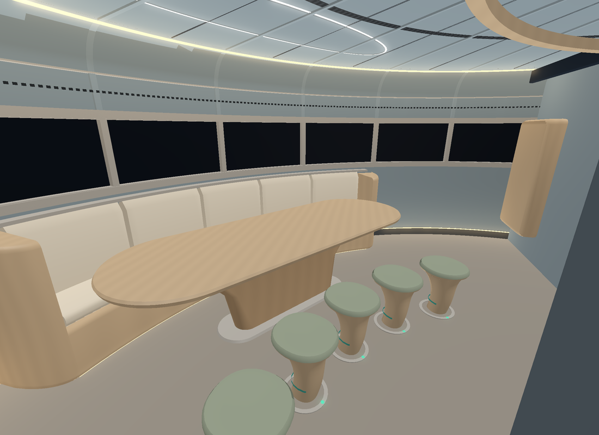
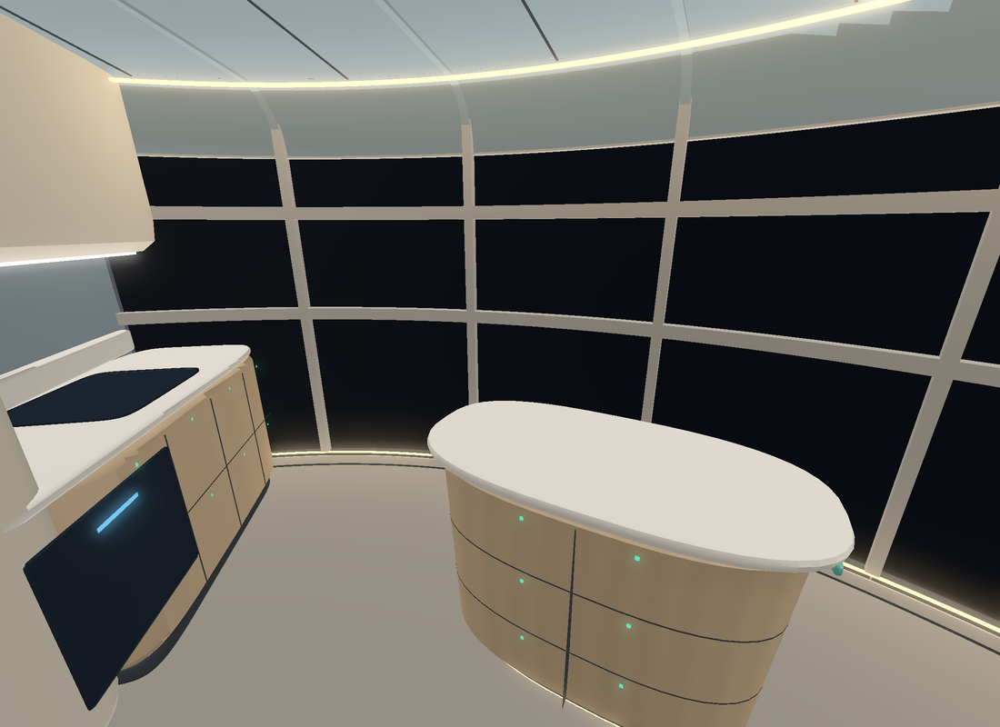
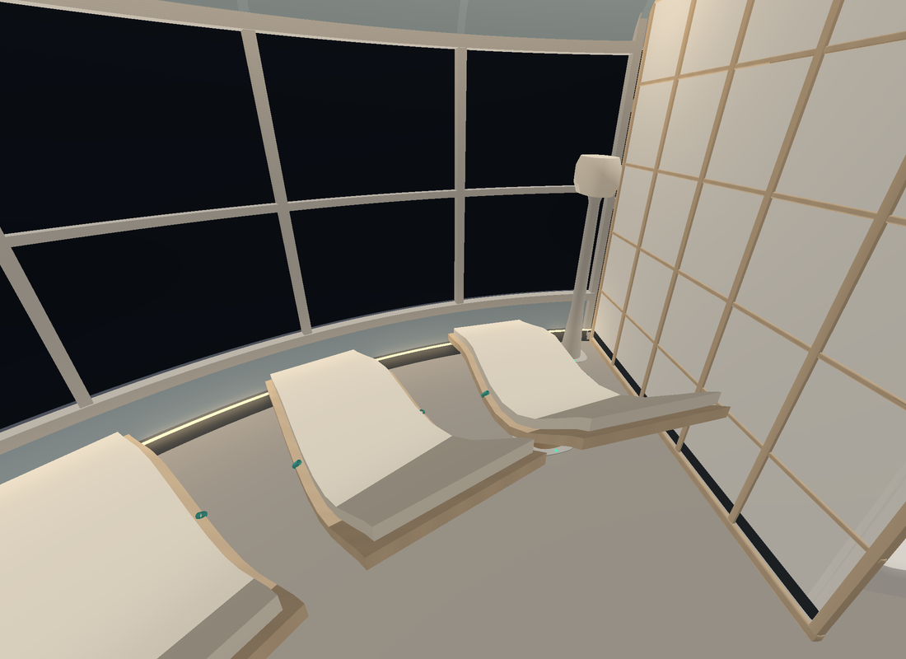
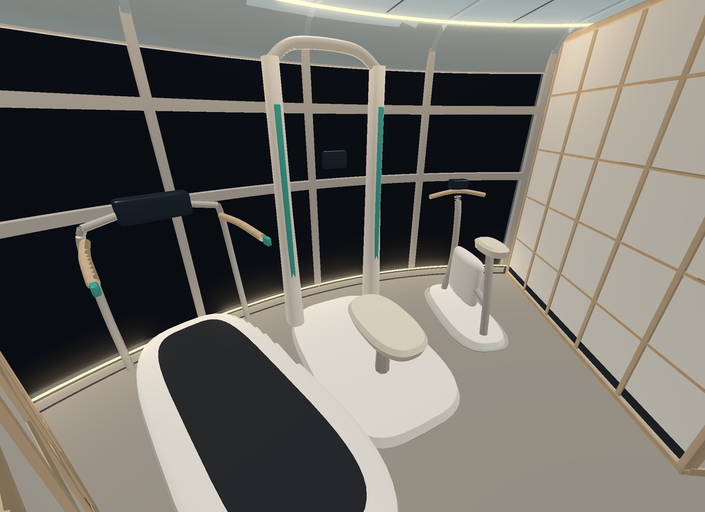
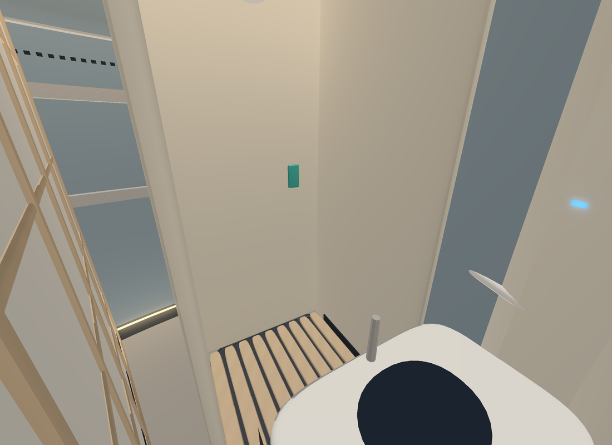
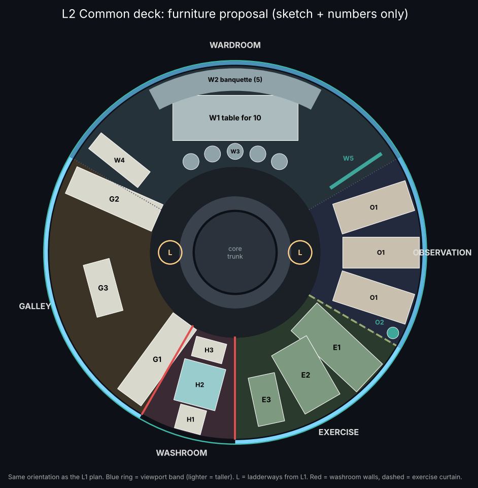
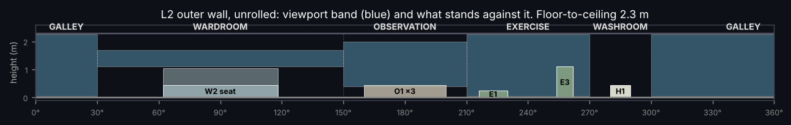
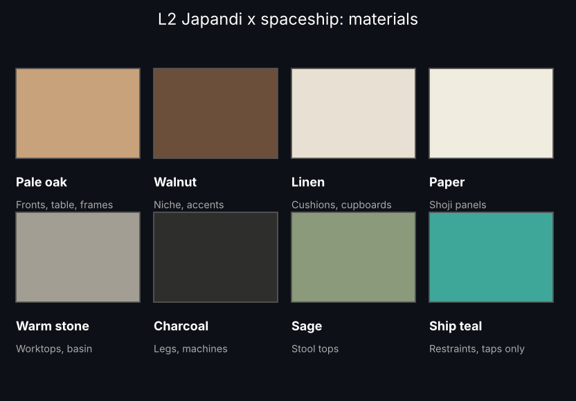

# Wayfarer L2 Common deck: Japandi x spaceship furniture (12 Nov 2026)
**ALL bodies. ALL sponsors. 2026-2226.**

**Status:** kT APPROVED the layout and the organic Japandi direction (pass 2, `L2_ORGANIC_STUDY_2026_11_12.md`) on 12 Nov 2026. The full-deck furniture in that language is FOR REVIEW.

**Current source:** `wayfarer/lab/l2_organic_study/` (`export.py` writes `render/out/proposal_L2_japandi.glb`, 23 nodes). It supersedes the first box-style generator, which has been deleted. Organic renders:

**Envelope screen (Claude, not D9):** r 1.30–4.15 m, h 0.00–2.30 m. No vertex lies inside the L1/L2 hatch leaves or the core racks. Ceiling ribs and reveals are kept out of the ladderway openings at 0° and 180°.

_Earlier box-style text follows; the item list and masses are unchanged._ Claude designed it. Not built. This is a rule F4 proposal package. Canon, BRep, mass and the exterior are unchanged. D9 has not been run. Rooms and purposes follow `WAYFARER_ROOM_REGISTER_2026_11_12.md` (PR #522). Furniture mass is paid from each room's own booking (`room_register_2026_11_12`).

## Design rules
- **Nothing tall against the glass.** Tall items sit on the room dividers or at the corridor end.
- **Japandi.** Pale oak and walnut, linen, paper-look shoji panels and warm stone, with charcoal hardware. Low furniture, flush handleless storage and a warm indirect cove light. One living niche.
- **Spaceship.** Restraints are built into the design: teal rails under the table, foot restraints and harnesses. Doors and screens slide; nothing swings. Everything is tethered or stowed. "Wood" and "paper" mean 2226 flame-retardant bamboo/lignin composites and ceramic-paper panels; they are a look, not real timber or paper.

## Items
| Node | Item | Purpose | Est. | Paid from |
|---|---|---|---:|---|
| L2_G1_cook_run | Cook run | Fridge-freezer column, oven/rehydrator, hob | 175 kg | room_L2-galley |
| L2_G2_water_run | Water run | Pantry column, sink, cleaner, compactor | 145 kg | room_L2-galley |
| L2_G3_prep_island | Prep island | Prep and standing meals with the view | 25 kg | room_L2-galley |
| L2_W1_table | Table for 10 | Meals and briefings | 35 kg | room_L2-wardroom |
| L2_W2_banquette | Banquette (5) | Seating with stowage below; back stays under the 1.1 m sill | 60 kg | room_L2-wardroom |
| L2_W3_stools | 5 stools | Seating with foot restraints | 25 kg | room_L2-wardroom |
| L2_W4_serving_pass | Serving pass | Galley to table | 40 kg | room_L2-wardroom |
| L2_W5_briefing_screen | Briefing screen | Folds down from the ceiling | 15 kg | room_L2-wardroom |
| L2_W6_living_niche | Living niche | Sealed hydroponic planter: greenery and herbs | 25 kg | room_L2-wardroom |
| L2_O1_loungers | 3 loungers | Off-watch viewing, feet to the glass | 75 kg | room_L2-observation |
| L2_O2_telescope | Telescope | Looking out properly | 20 kg | room_L2-observation |
| L2_E1_treadmill | Treadmill with harness | Exercise countermeasure | 180 kg | room_L2-exercise |
| L2_E2_resistance | Resistance machine | Bone and muscle countermeasure | 150 kg | room_L2-exercise |
| L2_E3_cycle | Cycle | Aerobic exercise | 60 kg | room_L2-exercise |
| L2_E4_shoji_screen | Shoji screen | Keeps noise and sweat in, lets light through | 20 kg | room_L2-exercise |
| L2_H0_walls_door | Washroom walls and sliding door | Privacy | 40 kg | room_L2-hygiene |
| L2_H1_toilet / H2_shower / H3_basin | Washroom fit | Hygiene | 175 kg | room_L2-hygiene |
| L2_D1_cove_light | Cove light | Warm indirect light | 30 kg | outfit_L2 |
| L2_D2_overhead_rail | Overhead rail | Zero-g handhold; gaps at the ladderways | 30 kg | outfit_L2 |

Room totals against their bookings:

| Room | Furniture | Booked |
|---|---:|---:|
| Galley | 345 kg | 2,047 kg |
| Wardroom | 200 kg | 1,228 kg |
| Observation | 95 kg | 614 kg |
| Exercise | 410 kg | 1,638 kg |
| Washroom | 215 kg | 614 kg |
| Deck-wide (outfit_L2) | 60 kg | 819 kg |

**No rebooking.** Dry mass 868.192255 t and ECON Δv 707.845 km/s are unchanged.

## Envelope (Claude screen, not D9)
- r 1.62–4.131 m and h 0–2.26 m. The ceiling is at h 2.30 and the room wall at r 4.15.
- The overhead rail leaves ±14° gaps at the 0° and 180° ladderways. It stays below r 1.83, where the L1/L2 hatch leaves are (h ≥ 1.68).

## Next
- kT reviews the style, with Nicole.
- Sol then builds `interior_L2.glb` (one GLB per deck, instancing for repeats, same extras schema) and runs D9 plus containment only.
- Open: the L2/L3 hatches are missing from the source (PR #522).
