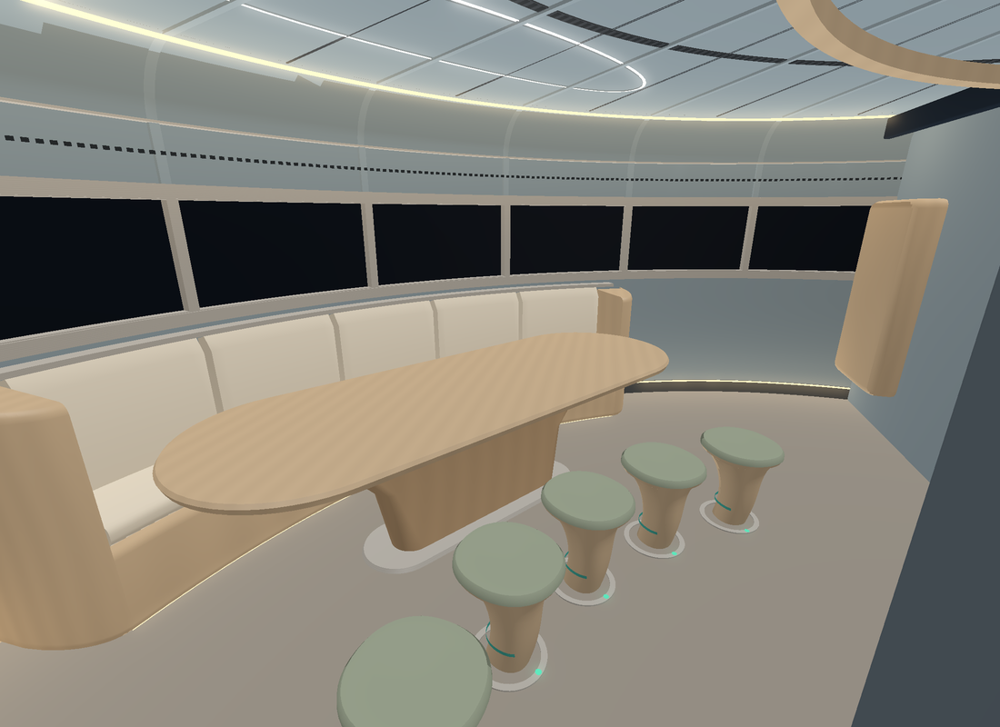
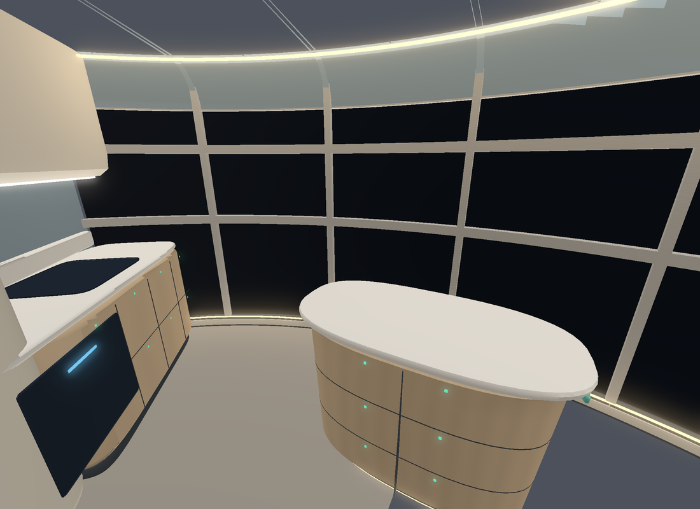

# L2 Organic Japandi design study: wardroom and galley (12 Nov 2026)
**ALL bodies. ALL sponsors. 2026-2226.**

**Status:** PROPOSE ONLY. This is a visual study. It has no physical geometry, mass or canon status. kT is the authority. Layout, bookings and footprints are as in `L2_JAPANDI_PROPOSAL_2026_11_12.md`.

**Source:** `wayfarer/lab/l2_organic_study/` (`geom.py` holds the geometry; `raster.py` is a z-buffer renderer).

**Run:** `python run.py ward` and `python run.py gal`.

**Viewpoints:** both are moved slightly from the reference views. The core trunk (r 1.25 m) was missing from the reference sketches and blocks them. The wardroom view is from the corridor at r 1.85 m and 40°. The galley view is from its corridor entrance at r 1.9 m and 352°.

## Wardroom: visible changes
- **Geometry**
  - The table is a racetrack top, 2.8 × 1.0 m (same footprint), with a rounded underside. It stands on one tapered blade support on a titanium floor dock.
  - The banquette is one continuous sweep. Its backrest leans with the hull, and its returns curve back into the wall.
  - The stools are tapered drums with domed cushions.
- **Material**
  - The hull lining is muted blue-grey with vertical panel reveals every 7.5°.
  - The table, banquette shell and stools are pale oak-look composite. Cushions are sand; stool tops are sage.
  - The window band is dark glass between brushed-titanium edge rings and mullions. A titanium trim line runs along the banquette top.
- **Integration**
  - The ceiling meets the wall in a curved cove with a continuous warm light reveal. The ceiling panels carry radial reveals.
  - A floor-wash light runs along the skirting.
  - Teal restraint ring under the table edge; teal docking rings under the stools.
  - The living niche is set into the 150° divider and lit from inside.

## Galley: visible changes
- **Geometry**
  - Each run is one continuous form: a tall broad-radius column at the corridor end flows into a convex-fronted base run.
  - The worktops are radiused off-white with an integrated splash upstand at the divider.
  - The island has an elliptical plan, a tapered recessed plinth and a teal handhold rail.
  - Upper cupboards appear on the washroom-wall run only. They have a soft belly and are built up to the ceiling. The water run is left open as a peninsula.
- **Material**
  - Fronts are pale oak-look; tall columns are sand and oak; worktops are warm off-white.
  - The hob, oven and cleaner are flush dark glass with cool-blue status lines.
- **Integration**
  - Appliances are recessed, with no exposed boxes.
  - Task light runs under the uppers. The cove light and floor-wash light continue from the wardroom.
  - The full-height draft glass (WWS-1) stays clear behind low counters.

## Acceptance criteria (Claude self-check)
1. **Fewer rectangular silhouettes:** yes. Only reveals, mullions and panel lines stay straight.
2. **Curves follow the architecture:** yes. Banquette, cove, lining and island all follow the hull radius.
3. **Continuity between wall, storage, seating and light:** yes. One cove light, skirting light and lining rhythm run round the deck.
4. **No unsecured furnishings:** yes. There are docking rings, restraint rails and flush latching fronts, and no loose props.
5. **Reads as a spacecraft without the view:** partly. The reveals, titanium rings, dark-glass controls and teal restraints carry it; the band is shown dark.
6. **Japandi without props:** yes. The only object is the hydroponic niche, which has a function.

## Refinement pass 2 (kT/Nicole: keep the direction, refine)
The images above are pass 2. The pass-1 renders are in git history. Target: 75% working spacecraft, 25% Japandi. No layout, footprint, mass or system changes.

- **Stools**
  - Before: straight tapered cones.
  - After: a curved, slightly asymmetric stem rises out of a flush titanium floor dock and flares into a concave sage seat.
  - Each has a teal latch collar and a green positive-lock indicator at the dock.
- **Galley island**
  - Before: one heavy ellipse.
  - After: a deep recessed plinth with a toe-kick wash and a body that tapers toward the base, with continuous rounded corners.
  - It has a dark shadow gap under a slimmer radiused worktop, flush drawers (two rows, centre seam), latch indicators and teal end handholds.
  - Footprint and internal volume are essentially unchanged.
- **Spacecraft detailing**
  - Shallow structural ribs continue each 15° mullion line up the lining, round the cove and across the ceiling. They are drawn only where there is lining.
  - A linear supply diffuser runs below the cove, only where there is lining, and there is a slotted return ring in the ceiling.
  - Flush access-panel outlines, low vent grilles and recessed dark-glass control panels with lock indicators sit on the 150° and 300° dividers.
  - Galley doors carry positive-lock indicators.
  - Cool task light runs under the uppers and as a racetrack line in the ceiling over the table. It sits alongside the warm cove and floor-wash light.
- **Materials (renderer)**
  - Timber-look composite has a fine, even grain, a composite rather than hardwood.
  - Ivory is matte. Brushed titanium has a higher sheen.
  - Warm cove and floor-wash light falls off the surfaces, and emissive strips have a soft glow.

## Glazing check against source
- **Rendered band matches the source geometry.** The wardroom band is h 1.10–1.70 m (30–150°). The galley is h 0.05–2.25 m (300–30°). Mullions are every 15° (`viewport_band.mullion_spacing_deg`). No window was created, enlarged or moved.
- **Correction from pass 1.** The source edge rings are `full_circle: true`, so the sill and head rings at 1.10 and 1.70 m now run all the way round. In the galley they cross the tall glass as transoms. WWS-1 round 2 books `l2_extra_transoms_t` 0.128 t but gives no heights, so placing the transoms at the ring heights is Claude's interpretation.
- **Discrepancy (documents, not rendering).**
  - `SPEC.md` still says the L2 band is 19.4 m².
  - The source now has 37.37 m² after WWS-1 round 2. The galley and exercise glass were extended to full height and accepted on 3–4 Nov 2026 as a **non-canon v0.5 design position**, marked DRAFT.
  - So the tall galley glass is real in the source geometry but not yet canon. kT should decide whether to keep it or return the galley to the 1.10–1.70 band.

STOP at visual review.
