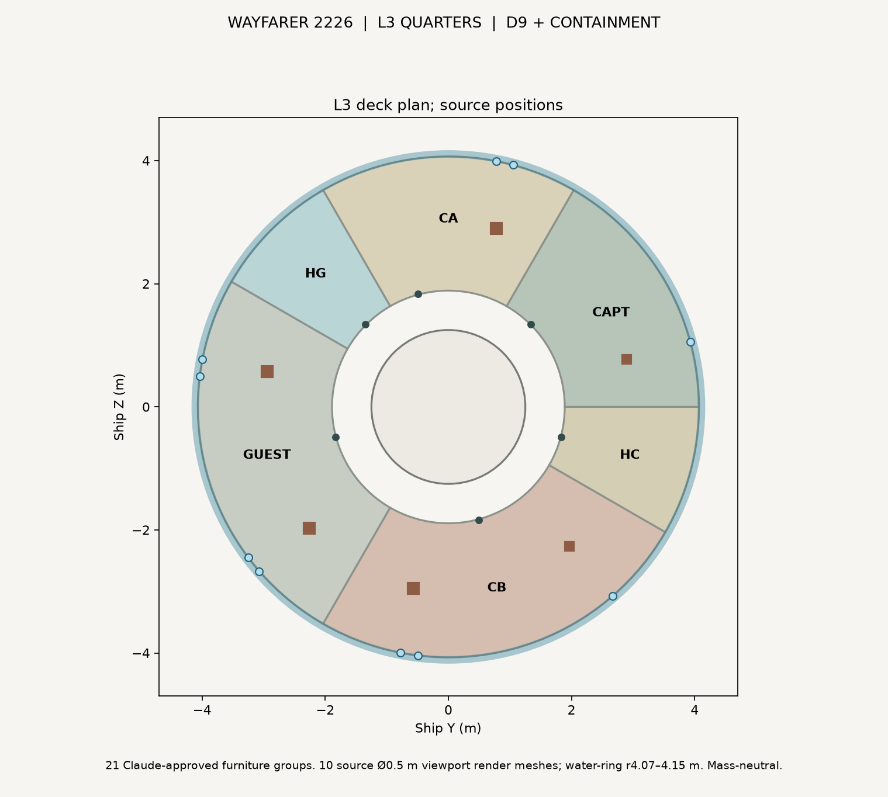

# Wayfarer L3 Quarters: organic Japandi furniture proposal (12 Nov 2026)
**ALL bodies. ALL sponsors. 2026-2226.**

**Status:** kT APPROVED on 12 Nov 2026 and **BUILT (PR #534)** from Claude's unchanged source-authored design. D9 category-d 0, containment PASS, no mass rebooking. The source-booked independent interior_L3.glb supersedes the proposal GLB. Other deck GLBs, source inventory, dry mass and the exterior are unchanged.

Berths, doors, walls and windows are taken unchanged from `wayfarer_v05_inputs.json` (L3 deck) and the source geometry. Mass rule: `room_register_2026_11_12` (each room's booking pays for its own furniture).

**Source:** `wayfarer/lab/l3_quarters/` (`l3geom.py`, `export3.py` and `run3.py`, using `../l2_organic_study`).

**Output:** `render/out/interior_L3.glb`: 21 original `proposal:L3_*` groups, P0 partitions split into six room-owned nodes, plus ten source-booked Ø0.5 m viewport detail nodes. 36 GLB mesh nodes, smooth normals; nonadditive mass references and no source mass changes. `proposal_L3_quarters.glb` deleted after a clean D9. Verification in `render/out/interior_L3_report.json`.

## Hatch interface (kT decision 12 Nov 2026)
The L2/L3 hatch flaps built in PR #526 hang into L3 at h 1.68–2.30 m. That puts them in front of the guest-cabin door (195°) and the crew-washroom door (345°). Their corners also reach r 1.945 m, about 2 cm into the upper guest berth's head end.

**kT decision:** flip the L2/L3 leaves so they open **upward into L2**. Parked open, each stands 0.92 m tall in L2 beside the ladder opening and acts as a guard rail. L3 then has no flaps. The mass and booking are unchanged; Sol re-runs D9. This model assumes the flip.

## Items and mass (estimates, including berths)
| Cabin / room | Items | Est. | Booked |
|---|---|---:|---:|
| Captain (1) | Berth pod, wardrobe with secure stowage, fold-down desk with secure terminal and docked seat, visitor seat | ~260 kg | 461 kg |
| Crew A (2) | Two-tier berth, 2 lockers, fold-down desk and seat | ~345 kg | 921 kg |
| Guest (4) | Two two-tier berths, 4 lockers, racetrack table and 2 docked seats | ~620 kg | 1,843 kg |
| Crew B (3) | Two-tier and single berths, 3 lockers, fold-down desk and seat | ~465 kg | 1,382 kg |
| Guest washroom | Toilet pod, shower cabin, basin | ~215 kg | 614 kg |
| Crew washroom | Toilet pod, shower cabin, basin | ~215 kg | 614 kg |
| Deck-wide (outfit_L3) | Lining, cove, lighting, overhead rail | ~145 kg | 819 kg |

- **Berth pods:** source tiers (frame 0.14, mattress 0.12, 0.82 m clear). Each has 5 g teal restraint straps, one solid side and a linen privacy screen. The headboard carries a reading light, vent, personal display and lock indicator, and the viewport is at the foot.
- **Cabin walls:** the source 4 cm partition and radial walls. Doors are 0.80 × 2.05 m sliding doors with a titanium track, lock indicator and recessed pull. Wall mass is shared from each room's booking.

**No rebooking.** Dry mass 868.192255 t and ECON Δv 707.845 km/s are unchanged.

## Envelope (Claude screen, not D9)
- r 1.30–4.07 m (the inner face of the water ring) and h 0–2.30 m.
- The berth viewports are drawn at Ø0.5 m, per SPEC. WWS-1 round 2 lists Ø0.8 m as a draft design position; neither size has been changed.
- Lockers, desks and seats were checked in plan against the berth footprints.

## L3 build verification (PR #534)

All six room partitions, berth tiers and headboards, furniture and doors remain at Claude's approved/source positions. Source Ø0.5 m viewports match window assemblies 11–20 in location and centre height. The source's Ø0.8 m WWS-1 alternative remains an unadopted draft design: no port resizing or pressure-seal qualification has been undertaken.

D9 category-d: **0**. Containment: **PASS**. Jacket-berth-ring positive intrusions: **0**. The D3 outer lining touches the r=4.07 m inside face of the source water ring, but does **not** extend into its protected thickness (checked at original triangle vertices, all three edge midpoints, and centroids). No one moved the lining. This sample-based water-ring screen is not a certified cutout/structural proof for the drawn viewport assemblies.

The L2/L3 leaves remain parked **up** into L2, not in the L3 cabins. L3/L4 _0 stays radially stowed in the L3 floor pocket; _1 remains as approved.

The mass estimates remain 260 kg captain, 345 kg crew A, 620 kg guest, 465 kg crew B, 215 kg per washroom, and 145 kg of L3-wide outfit. Source bookings are unchanged, no rebooking. Dry 868.192255 t, ECON Δv 707.845 km/s, G1–G12 NOT RUN.

