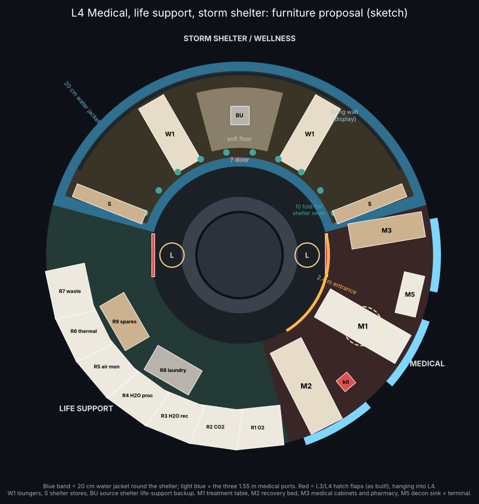
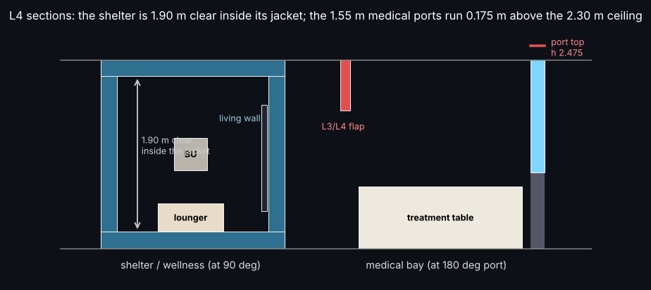
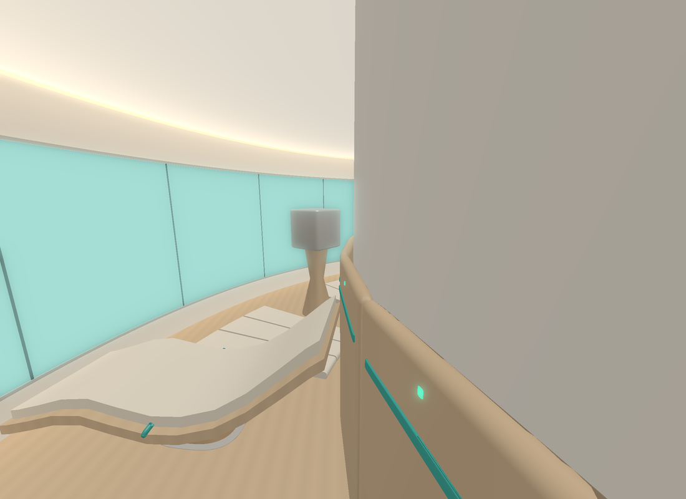
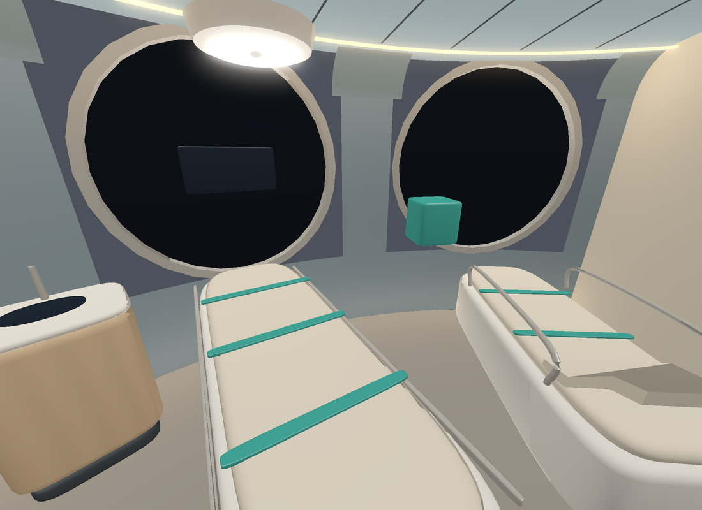
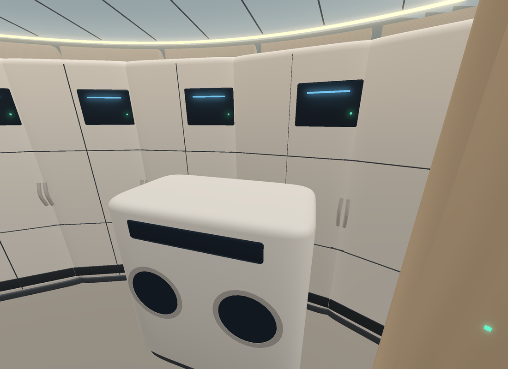
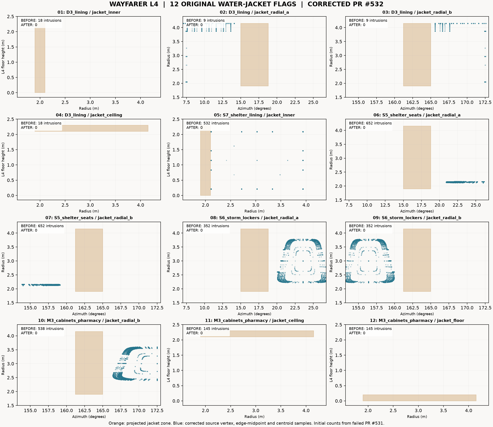
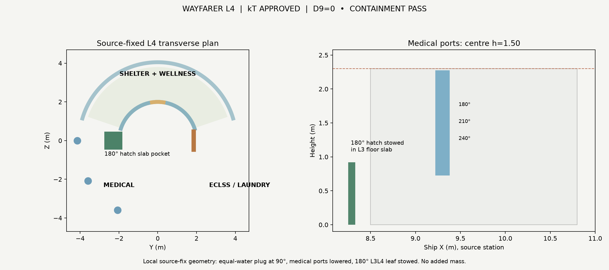

# Wayfarer L4: medical, life support, storm shelter / wellness room (12 Nov 2026)
**ALL bodies. ALL sponsors. 2026-2226.**

**Status:** kT APPROVED and **BUILT**, D9 category-d 0, containment PASS after Claude's narrow PR #532 jacket-clearance correction. L4-shelter is both the storm shelter and day-to-day wellness room. No mass rebooking, other-deck or exterior GLB changes.

**3D model:** Claude's corrected `wayfarer/lab/l4_decks/l4geom.py` (same approved geometry consumed by `export4.py`) is compiled by `integrate4.py` into independent `render/out/interior_L4.glb` with source-booked nonadditive extras and smooth normals. The 19-node `proposal_L4.glb` is superseded and deleted. See `render/out/interior_L4_report.json`.

**Envelope (Claude screen, not D9):** r 1.30–4.15 m and h 0–2.30 m. Shelter items stay inside the jacket interior (r 2.1–3.95, h 0.20–2.10). The life-support partition stops at 344°, clear of the 0° L3/L4 hatch leaf.

**Added in modelling** (room bookings; no new mass):
- warm lining inside the shelter jacket;
- a life-support acoustic partition with a 1.2 m maintenance door at 315°;
- short partition stubs either side of the 2.4 m medical entrance.

## Storm shelter = wellness room (L4-shelter, 1.024 t)
Nicole asked for a wellness room, and kT decided the shelter is it. The room is 1.90 m clear inside the 20 cm water jacket (18.8–161.2°, r 2.1–3.95).

- **Wellness mode (day to day)**
  - A curved living wall of displays (waterfall, home, games), shown at 28–152° on the outer jacket face.
  - Two loungers and a soft floor zone.
- **Storm mode (storms, radiation belts)**
  - The displays switch to ship status and comms.
  - Loungers and the soft floor stow; ten fold-flat restraint seats deploy from the inner jacket wall.
  - The switch takes about 10 minutes.
  - 72 h of life support comes from the source `shelter_backup` unit, which is given a slim stand.
- **Storm supplies:** two lockers at the jacket ends.
- **Estimated mass:** about 285 kg.

## Medical bay (L4-medical, 3.071 t)
- **M1:** treatment table that takes the rigid stretcher, with an overhead exam light.
- **M2:** recovery bed under the 240° port.
- **M3:** cabinet and pharmacy run.
- **M5:** decontamination sink and terminal.
- **Rescue kit:** the source item stays where it is.
- **Estimated mass:** about 490 kg.

## Life support (L4-eclss, 14.311 t)
- **R1–R7:** equipment racks round the outer wall: O2 generation, CO2 removal, water recovery, water processing, air monitoring, thermal, and waste.
- **R8:** laundry module, which settles the open laundry item.
- **R9:** spares.
- The racks draw the booked life-support equipment; nothing new is booked.

## kT decisions (recorded in kt_decisions.json, `l4_decisions_2026_11_12`)
1. **Shelter door.** The source shelter had no entrance. A 0.8 m water-filled sliding plug door goes in the inner jacket at 90°. It holds the water it replaces, so it is mass-neutral and keeps the shielding when closed.
2. **Medical ports.** The three 1.55 m ports move down from centre h 1.70 to h 1.50 (x 9.10 → 9.30), so their tops sit at h 2.275, below the 2.30 m ceiling. Size and azimuths are unchanged.
3. **L3/L4 hatch at 180°** (`hatch_L3L4_0`, Y −1.86; `_1` is the 0° leaf). This leaf becomes a sliding leaf that stows radially into the L3 floor slab, clear of the casualty path from the port ladder into the 2.4 m medical entrance. The 0° leaf is unchanged.

No rebooking. Dry mass 868.192255 t and ECON Δv 707.845 km/s are unchanged.

## Jacket clearance correction (Claude, 12 Nov 2026, after Sol's D9 on PR #531)
Sol's D9 on PR #531 flagged 12 protected-water intrusions. All of them were Claude's geometry touching or entering the 20 cm shelter jacket. The fixes are narrow; the layout and items are unchanged.

- **D3 lining and cove:** now stop 0.6° short of the jacket radial ends (165° and 15°). No ceiling reveals run over the jacket (14–166°).
- **S7 shelter lining:** moved 10 mm inside every jacket face.
- **S5 shelter seats:** 0.38 m wide (was 0.44) at 26–70° and 110–154°, clear of the radial ends.
- **S6 storm lockers:** moved 4.8° in from the radial ends and kept 10 mm off the jacket floor and 30 mm off the ceiling.
- **Loungers, soft floor, backup stand:** lifted 5–15 mm off the jacket floor.
- **M3 pharmacy:** moved to 172.5° and shortened to r 2.4–3.6, clear of `jacket_radial_b` and set back from the 180° port.
- **Medical partition stub:** now starts at 165.6°.

**Claude screen:** no vertex, edge midpoint or triangle centroid lies inside any of the six jacket solids (the plug-door opening is excluded). Sol re-runs D9.

## Verified L4 D9 clearance, PR #531

All 12 original protected-water flags are resolved. The corrected geometry is checked at vertices, three edge midpoints and triangle centroids against six jacket solids. D9 category-d = **0**; containment **PASS**; every room is within its booked mass. No G1–G12. The figure shows one panel per original flag: original sampled-hit counts from failed PR #531 and corrected geometry samples (not reconstructed pre-fix coordinates).

The water plug is a source-local, closed-state shielding-mass representation; no pressure-seal or actuating mechanism qualification is claimed. Original source mass and exterior six-state GLBs remain unchanged. Dry 868.192255 t, ECON Δv 707.845 km/s.

**Release-evidence note:** The 12-panel image is an individually labelled comparison of the original failed D9 flag counts and corrected geometry samples; it does not reconstruct or infer unrecorded pre-fix collision coordinates. The authoritative passing D9, containment, item bookings and generated GLB hash are in `render/out/interior_L4_report.json`.
