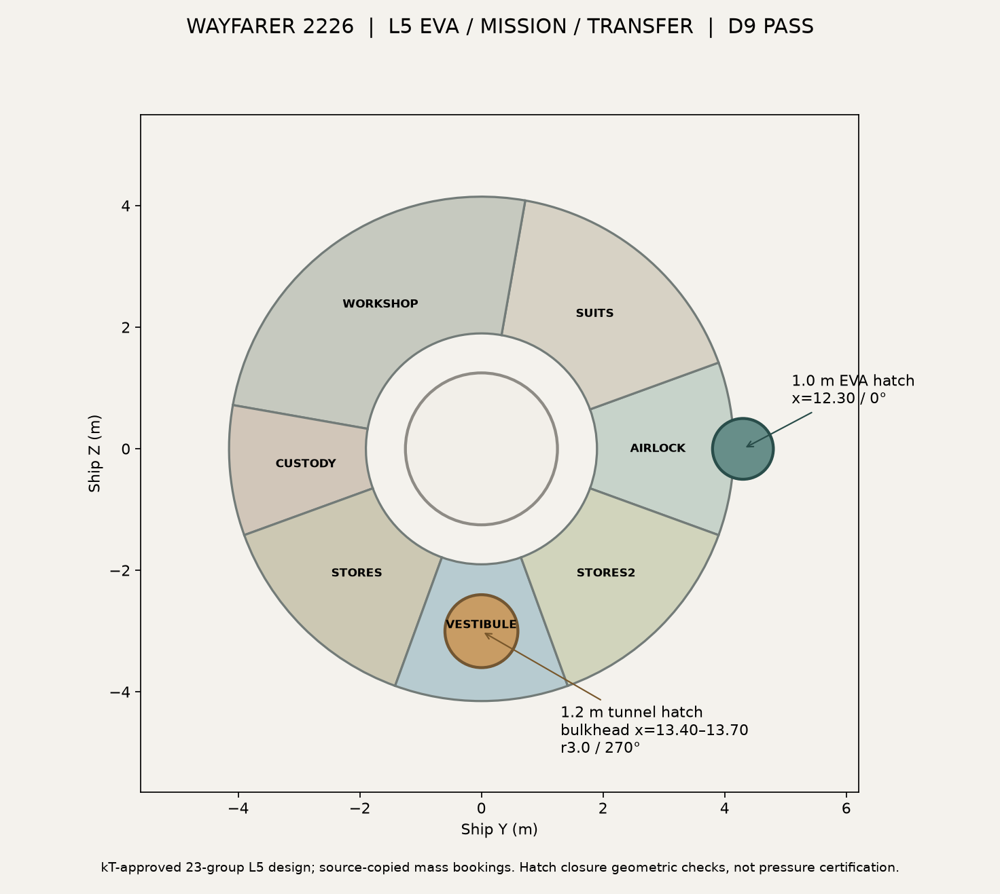
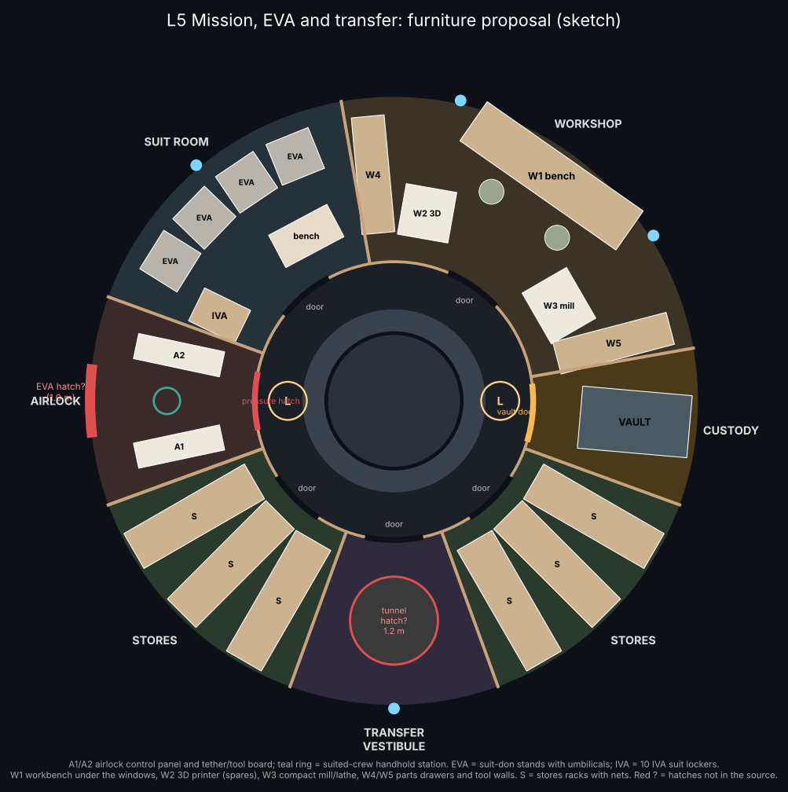
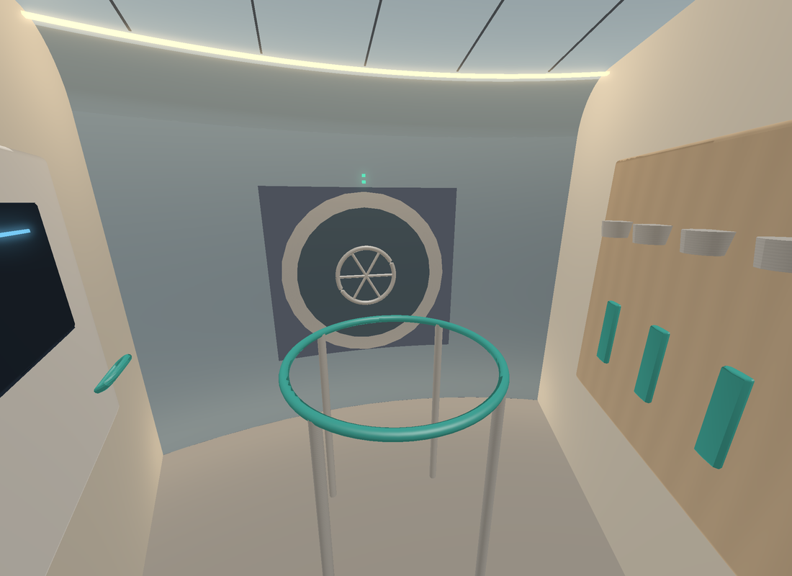
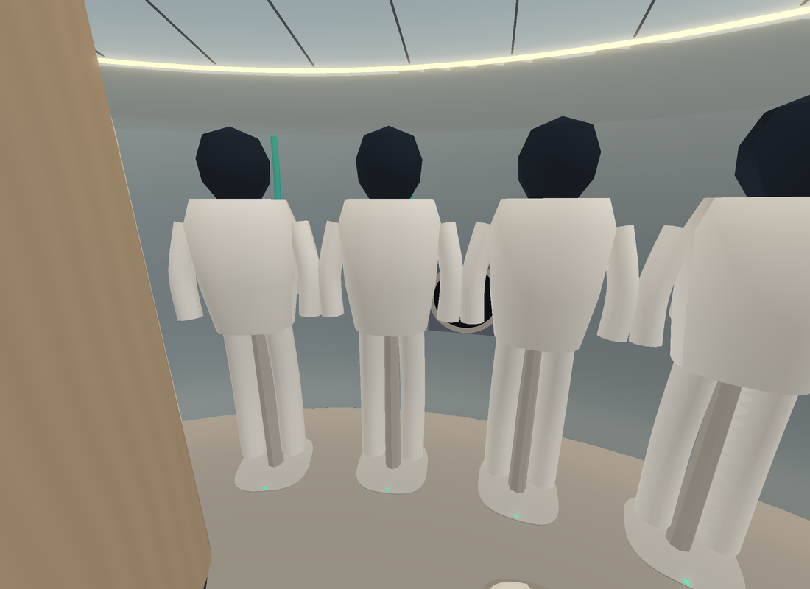
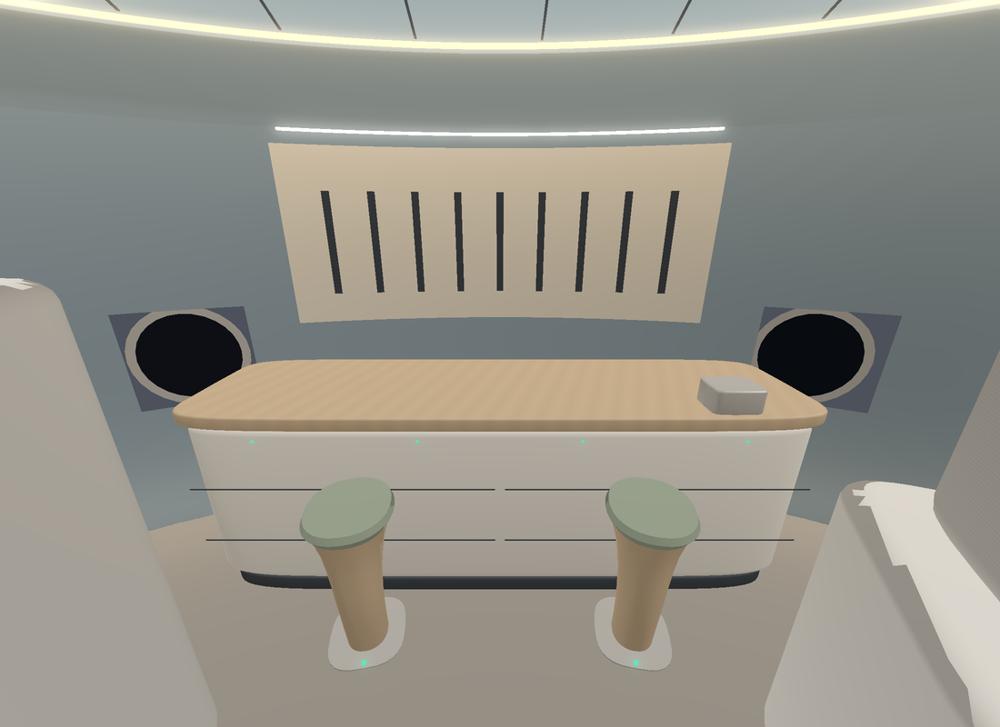
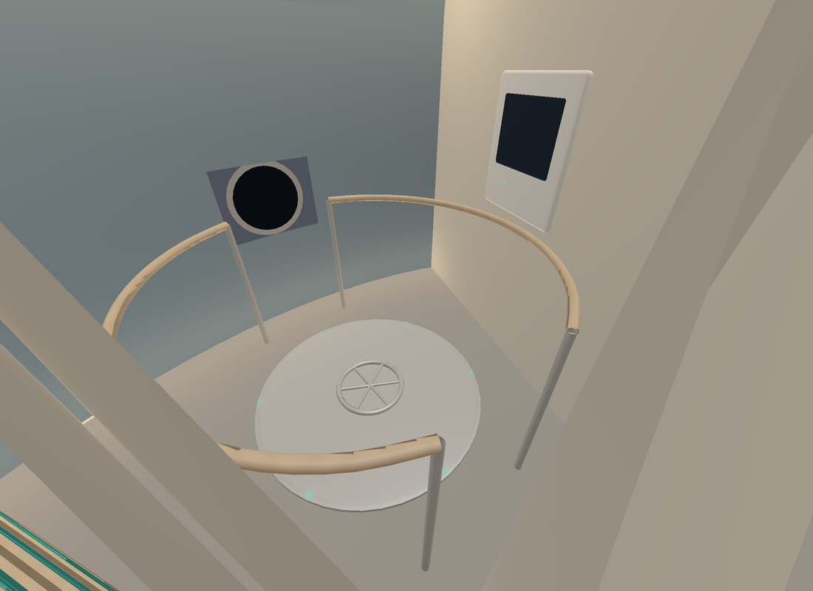

# Wayfarer L5 Mission, EVA and transfer: furniture proposal (12 Nov 2026)
**ALL bodies. ALL sponsors. 2026-2226.**

**Status:** kT APPROVED 12 Nov 2026. **Built and verified** as independent `wayfarer/render/out/interior_L5.glb` under PR #533. D9 category-d = 0, containment PASS, zero mass rebooking. Original proposal GLB deleted after validation. The source EVA/tunnel cutouts and closed plugs were checked as source-bound overlays; original published exterior GLBs have **not** been recut. Pressure seals, open-hatch shielding and structural strength remain unqualified. Rooms follow the approved register; each room's booked allocation pays for its items.

**Source:** `wayfarer/lab/l5_deck/` (`l5geom.py` and `export5.py`, using `../l2_organic_study`).

**Output:** `render/out/interior_L5.glb` (23 original `proposal:L5_*` groups represented in 81 mesh nodes, 49 unique meshes; P0 walls split by room, rigid repeats instanced). Report `render/out/interior_L5_report.json`, source hatch check `render/out/interior_L5_source_report.json`. The original `proposal_L5.glb` is superseded and deleted.

| Room | Items | Est. | Booked |
|---|---|---:|---:|
| Airlock | Inner pressure hatch at the 0° ladder, depress/repress control panel, tether and tool board, handhold ring, **EVA hatch** | ~580 kg | 3,071 kg |
| Suit room | 4 EVA suit stands with umbilicals (suits included), 10 IVA compartments, donning bench, by the window | ~890 kg | 1,536 kg |
| Workshop | Bench between the windows with shadow board and vise, 3D printer for spares, mill/lathe, parts walls, two stools | ~740 kg | 3,071 kg |
| Custody | Armoured vault with keypad and tamper lights, vault door | ~410 kg | 512 kg (tight) |
| Stores ×2 | Three racks each, with stowage bags and teal straps | ~200 kg each | 3,071 kg each |
| Transfer vestibule | **Tunnel floor hatch**, handrails, pressure-check panel | ~180 kg | 307 kg |
| Deck-wide (outfit_L5) | Lining, cove light, overhead rail | ~145 kg | 819 kg |

## kT decisions (`l5_decisions_2026_11_12`)
1. **EVA hatch.** 1.0 m, in the airlock outer wall at 0°, centre h 1.1, between the EVA rails. The source had none, although SPEC refers to "the L5 hatch".
2. **Tunnel hatch.** 1.2 m, in the vestibule floor (aft bulkhead) at r 3.0, 270°, matching `tunnel_0`. The source had none.

Both are cut-outs that Sol must check (pressure, armour and D9). There is no rebooking. Dry mass 868.192255 t and ECON Δv 707.845 km/s are unchanged.

## Envelope (Claude screen, not D9)
Furniture sits at r 1.30–4.15 m and h 0–2.30 m. The EVA hatch frame sits in the hull thickness, up to r ≈ 4.17.

**Verification (PR #533):** EVA hatch centre x=12.30, 0°, diameter 1.0 m; tunnel hatch r=3.0, 270°, diameter 1.2 m, aligned to `tunnel_0`. Closed plug reconstruction matches source solids by zero symmetric-set difference; OCCT reports 0.009445 m³ and 0.064594 m³ nonadditive shell-volume residuals, preserved in the source report rather than hidden. Exact pressure, armour and bulkhead closure geometry only. 23 item groups carry nonadditive source-booking metadata; custody 410/511.852 kg, vestibule 180/307.111 kg (including the 150 kg hatch), outfit_L5 145/818.963 kg. Dry 868.192255 t and ECON Δv 707.845 km/s unchanged; G1-G12 not run.
