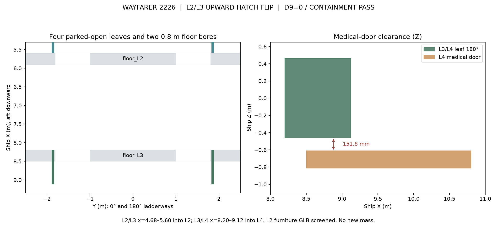

# Wayfarer interdeck pressure hatch leaves, 12 Nov 2026
**ALL bodies. ALL sponsors. 2026-2226.**

**Authority:** kT originally approved two normally-open leaves at each L2/L3 and L3/L4 interface using the original L1/L2 box. **kT flip decision 12 Nov 2026:** L2/L3 leaves are now hinged at x=5.60 and parked **UP into L2**, x=4.68–5.60 (h=0–0.92 m), forming a guard at each ladder opening. L3/L4 leaves remain parked into L4, x=8.20–9.12. No furniture or viewport position changes.

**Physical output:** `wayfarer/render/out/interior_deck_hatches.glb` is an independent interior assembly. It contains four named hatch leaves and a floor_L2/floor_L3 representation with the same two 0.80 m bores cut as the approved L1 interior. Cut material earns no mass savings. These are replacement visual floor solids, not additions alongside uncut source floor solids.

**Mass:** source dry 868.192255 t and ECON delta-v 707.845 km/s remain unchanged. Each new leaf has a 0.15 t estimate from existing room-outfit allowances: 0.30 t from outfit_L2 (818.963 kg booked, 145 kg prior drawn estimate, 373.963 kg left afterwards), and 0.30 t from outfit_L4 (818.963 kg booked, no prior separately drawn items identified, 518.963 kg left). Rebooking zero.

**D9:** strict source-geometry BRep intersections against physically modeled fixtures **plus exact triangle clipping against every physical mesh and instance in the committed `interior_L2.glb`**; identical L1/L2 hinge-to-floor mounting treated as known category-c attachment. The L4 medical door stands 151.75 mm away in Z from the negative-Y (180-degree) parked L3/L4 leaf. The L2/L3 flip removes the leaf obstruction previously identified at L3 guest and washroom doors and the upper guest berth. The committed 29-node L2 GLB (127,432 triangles including repeated mesh instances) has **zero** intrusions. The galley G2 water-run column is closest to `hatch_L2L3_1`: true geometric clearance is conservatively bounded between **67.762 mm** (triangle AABB lower bound) and **76.304 mm** (closest sampled mesh vertex upper bound). The opposite leaf has no nearby galley interference. L3/L4 is unchanged, including its unmodeled L3 partitions and physical pressure-seal limits.

**Containment:** preserve full pressure hull; hatches are entirely inside the source pressure-cylinder envelope. This is not a physical seal, pressure, fire or actuation qualification. G1-G12 not required and not run.

**Viewer:** source viewer remains unchanged unless the exterior GLB changes. None of the six exterior states or existing L1 and L2 GLBs is modified.

Checks and hashes: `wayfarer/render/out/interior_deck_hatches_report.json`. If checks fail, leave this as unmerged work and preserve the failure report.
