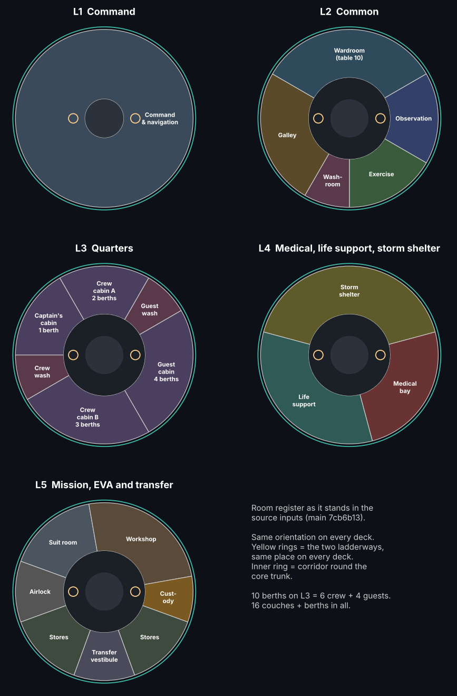

# Wayfarer room register (12 Nov 2026)
**ALL bodies. ALL sponsors. 2026-2226.**

**Status:** kT APPROVED on 12 Nov 2026, before any L2 furniture is committed. This is the list of what every room on every deck is for. It is taken unchanged from `wayfarer/config/wayfarer_v05_inputs.json` (`habitat.decks`). Decisions are recorded as `room_register_2026_11_12` in `kt_decisions.json`. No canon, geometry or mass changes.

## Rooms
Angles follow the source sector convention: Y = r·cos a, Z = r·sin a. Mass is each room's booking, in tonnes.

| Deck | Room id | Name | Angle | Mass t | Purpose |
|---|---|---|---|---:|---|
| L1 | `L1-command` | Command and navigation | 0–360° | 2.1 | Flying, navigating and commanding the ship; six B3 stations under the crown |
| L2 | `L2-galley` | Galley | -60–30° | 2 | Cooking and food prep for 10 |
| L2 | `L2-wardroom` | Wardroom (table for 10) | 30–150° | 1.2 | Meals, briefings and social time; table for 10 |
| L2 | `L2-observation` | Observation | 150–210° | 0.6 | Off-watch viewing lounge on the tallest glass |
| L2 | `L2-exercise` | Exercise | 210–270° | 1.6 | Daily exercise against bone and muscle loss |
| L2 | `L2-hygiene` | Washroom | 270–300° | 0.6 | Toilet, washing and shower |
| L3 | `L3-CAPT` | Captain's cabin (1 berth) | 0–60° | 0.45 | Sleep and privacy; berths with 5 g restraints behind the water ring |
| L3 | `L3-CA` | Crew cabin A (2 berths) | 60–120° | 0.9 | Sleep and privacy; berths with 5 g restraints behind the water ring |
| L3 | `L3-HG` | Guest washroom | 120–150° | 0.6 | Toilet, washing and shower |
| L3 | `L3-GUEST` | Guest cabin (4 berths) | 150–240° | 1.8 | Sleep and privacy; berths with 5 g restraints behind the water ring |
| L3 | `L3-CB` | Crew cabin B (3 berths) | 240–330° | 1.35 | Sleep and privacy; berths with 5 g restraints behind the water ring |
| L3 | `L3-HC` | Crew washroom | 330–360° | 0.6 | Toilet, washing and shower |
| L4 | `L4-shelter` | Storm shelter | 15–165° | 1 | Storm and radiation refuge for 10 (72 h life support); day-to-day wellness room |
| L4 | `L4-medical` | Medical bay | 165–255° | 3 | Treatment and recovery; casualty arrives at 0 g by the port ladder |
| L4 | `L4-eclss` | Life support | 255–375° | 14 | Air, water and waste processing |
| L5 | `L5-airlock` | Airlock | -20–20° | 3 | EVA exit and entry |
| L5 | `L5-suits` | Suit room | 20–80° | 1.5 | Suit stowage, donning and maintenance |
| L5 | `L5-workshop` | Workshop | 80–170° | 3 | Repairs and fabrication |
| L5 | `L5-custody` | Custody locker | 170–200° | 0.5 | Vault for the secure courier consignment |
| L5 | `L5-stores` | Stores | 200–250° | 3 | Food, spares and consumables |
| L5 | `L5-vestibule` | Transfer vestibule | 250–290° | 0.3 | Docking transfer to the shuttle and other craft |
| L5 | `L5-stores2` | Stores | 290–340° | 3 | Food, spares and consumables |

There are 10 berths (6 crew + 4 guests) and 16 couches and berths in all. The two ladderways sit at 0° and 180° on every deck.

## Decisions (kT, 12 Nov 2026)
1. **Furniture mass rule.** Each room's booked mass is its equipment and furniture allowance. `outfit_<deck>` covers linings, handholds, cables, ducts, lighting and fire detection. Furniture is paid from its own room's booking first, and nothing is rebooked. The 12 Nov L1 wording ("room_* are empty-space semantic volumes") means the room volume is not drawn as a solid. Its mass is still the room's allowance. The L1 wall fit-out stays on `outfit_L1` as built.
2. **Wellness room.** The L4 storm shelter is the wellness room day to day and switches to shelter mode for storms and radiation events.
3. **Courier custody.** `L5-custody` is the vault for the secure consignment. The L1 courier strongbox is the ready box for the current delivery and the ship's keys, under the captain's control.

## Open items (for Sol)
- **DECIDED by kT 12 Nov 2026:** L2/L3 and L3/L4 get two normally-open copies of the L1/L2 leaf each, at 0°/180°, paid 0.300 t per boundary within outfit_L2 and outfit_L4. Draw floor_L2 and floor_L3 with two Ø0.80 m ladder bores as the accepted L1 visual precedent. See `deck_hatches_2026_11_12` and `WAYFARER_DECK_HATCHES_2026_11_12.md`. This resolves the design open item, not the untested physical pressure-seal/closure qualification.
- **LAUNDRY PROPOSAL ONLY:** place laundry inside the existing L4 life-support room (`L4-eclss`) near water/waste processing. This is not an approved assigned room, layout, item, equipment booking or change to mass. Fit and utility routing remain untested.

Resolved by the 12 Nov 2026 L2 tidy: `SPEC.md` L1 row updated to six B3 stations and x 0.2–3.0; superseded `render/out/proposal_L1_stations_B3.glb` removed.
