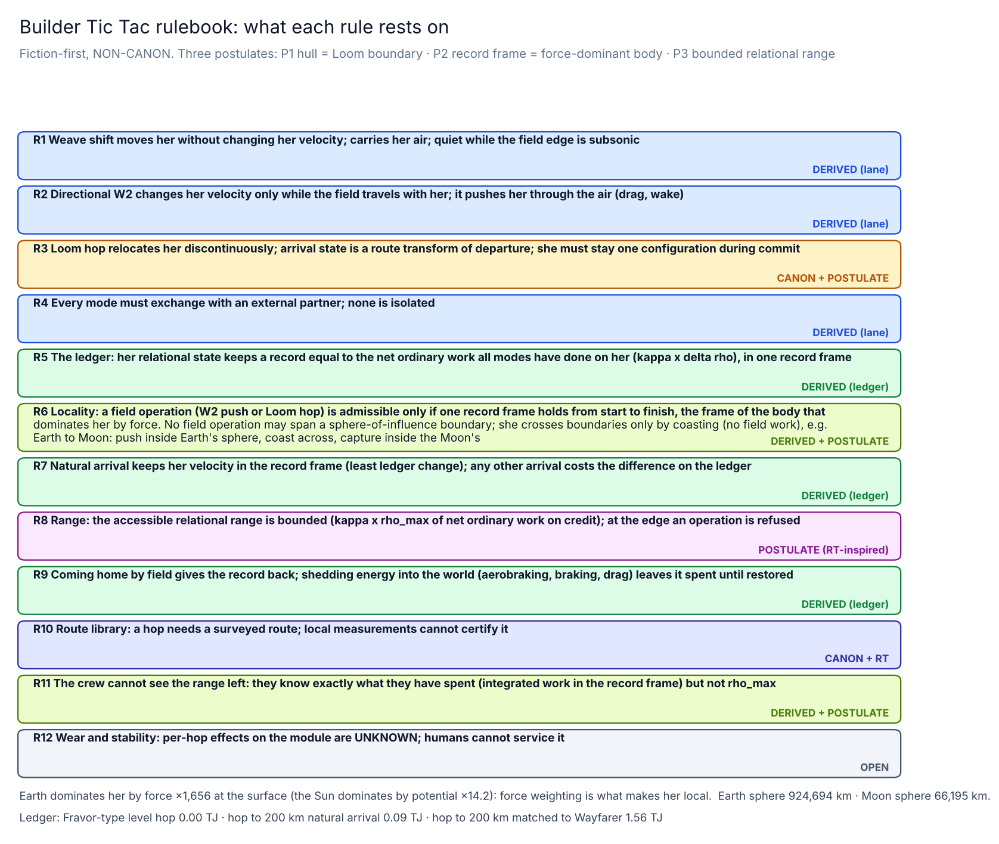

ALL bodies. ALL sponsors. 2026-2226.

# Builder Tic Tac rulebook, derived from our speculative physics

**Status:** fiction-first, NON-CANON. Each rule says what it rests on. The torch configuration remains the reference design.
**Code:** `builder_rulebook.py` → `builder_rulebook.json`; `builder_rulebook_figure.py` → `weave_builder_rulebook.png`.

## Three postulates (everything else is canon or derived)

- **P1.** The continuous active hull is her interface for the Weave and W2 fields and her **Loom boundary**: 153 m², against the ~1,900 m² of controlled boundary Wayfarer needs.
- **P2.** The **record frame** is the frame of the body that dominates her **by force**.
- **P3.** Her accessible relational range is **bounded**, in the spirit of RT-C1: control distance is not spatial distance.

## The rules

| # | Rule | Rests on |
|---|---|---|
| R1 | The Weave shift moves her without changing her velocity, carries her air, and is quiet while the field edge is subsonic | LANE (homogeneous motion law; ideal-fluid transport; edge Mach limit) |
| R2 | Directional W2 changes her velocity only while the field travels with her, and pushes her through the air | LANE (continuous-hull screen C; lapse dash) |
| R3 | A Loom hop relocates her discontinuously. Her arrival state is a route transform of her departure state, and her configuration is locked during commit | CANON §12, §12.1, plus P1 |
| R4 | Every mode exchanges momentum with an external partner; none is isolated | LANE (ADM charges and the boost-charge argument) |
| R5 | **The ledger:** her relational state records the net ordinary work all modes do on her, in one record frame. The Weave shift adds nothing | LEDGER (no-free-work requirement) |
| R6 | **Locality:** a field operation (W2 push or Loom hop) needs one record frame from start to finish, the force-dominant body's. No field operation may span a sphere-of-influence boundary: she crosses boundaries **only by coasting** | LEDGER (work is frame-dependent, so the record needs a single frame) plus P2 |
| R7 | A natural arrival keeps her velocity in the record frame, the smallest ledger change. Any other arrival costs the difference | LEDGER |
| R8 | Her range holds at most κ·ρ_max of net work on credit; at the edge an operation is refused | P3 (RT-inspired); refusal from the cycle screen |
| R9 | Coming home by field gives the record back. Shedding energy into the world leaves it spent until it is restored | LEDGER (route dependence, cf. RT-B1) |
| R10 | **Route library:** a hop needs a surveyed route, because local measurements cannot certify it | CANON §12.1, plus RT (SHG1: locally identical configurations can sit in different global sectors; RT-B1/C1) |
| R11 | The crew knows exactly what they have **spent**, but not what is **left** (ρ_max) | LEDGER plus P3 |
| R12 | Wear and stability per hop are unknown, and humans cannot service the module | OPEN: narrative, not derived |

## Why force weighting, in numbers

At Earth's surface, Earth's pull on her is **1,656×** the Sun's, while the Sun's potential is **14×** Earth's.
- **Potential weighting** would make the Sun the partner everywhere: no gravity-well tether.
- **Force weighting** gives locality. The tether is Earth's sphere of influence, 924,700 km (Hill sphere 1.5 million km). The Moon's is 66,200 km.

## Ledger costs

| Manoeuvre | Ledger |
|---|---|
| Fravor-type hop, 111 km at constant altitude and speed | **0** |
| Hop from the surface to 200 km, natural arrival | 0.09 TJ (height only); she arrives with no orbital speed |
| Hop from the surface to 200 km, matched to Wayfarer | 1.56 TJ |
| Any hop and its reverse | 0 |
| Earth to Moon | Push inside Earth's sphere (ledger, Earth frame), coast across the boundary, capture inside the Moon's sphere (ledger, Moon frame) |

## What this gives the setting

- **Locality** falls out of the physics: there are no interstellar hops, and Wayfarer's Loom keeps that role.
- **Routes** must be explored before they can be used.
- **Her capability** is one number, κ·ρ_max. The crew can never see how much is left, only how much they have spent.
- **The Fravor moment** is free in the ledger: a level hop of a few tens of miles inside Earth's well, along a mapped route.

## Still open

- **Restoring a spent record:** only by unwinding, or by paid environmental relaxation?
- **The value of κ·ρ_max:** a kT choice.
- **Each mode's local heat.**
- **A tie rule for P2 near boundaries:** around the Earth–Moon L1 region, which body counts as dominant?
