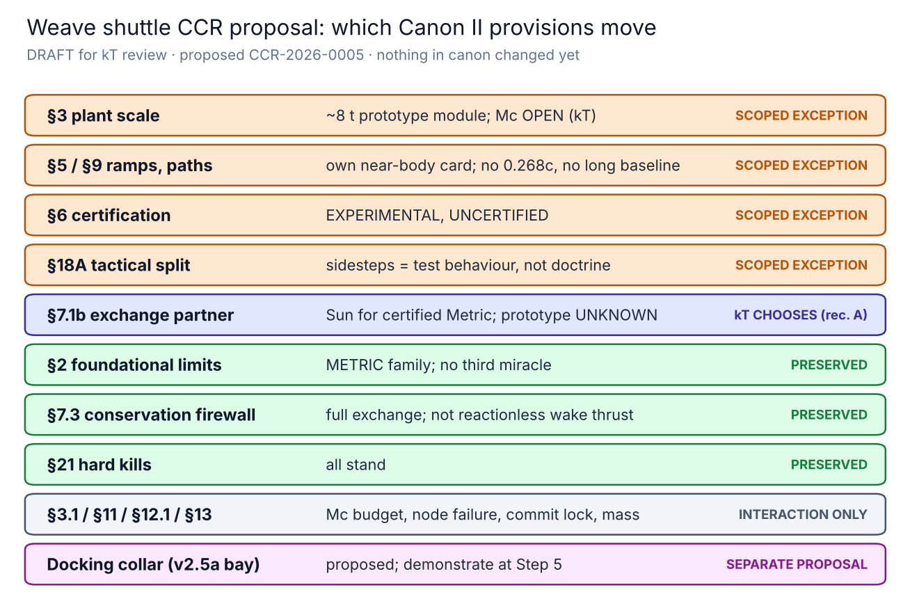

ALL bodies. ALL sponsors. 2026-2226.

# CCR proposal (draft for kT review): Weave shuttle prototype scope

**Status:** DRAFT, NOT FILED. Proposed ID CCR-2026-0005, which is allocated only when filed on `main`.
**Step:** 4 of the Sol-approved finalization sequence (CCR scoping).
**Changes nothing:** no governing canon, governance record, released GLB, `canon_glb.json` or geometry is modified by this draft.

## 1. What is being asked

Admit the Weave shuttle (13.02 m Osteon lifting body, W2 cushion plus Weave shift, ~8 t Builder relational module, wings/fans/floats fallback) into Canon II as a **scoped experimental prototype** of the existing METRIC regime. It is not a new regime, not a certified drive, and not a replacement for the Wayfarer's certified Metric card.

| CCR field | Proposed value |
|---|---|
| source_type | MIXED (FICTIONAL_DESIGN_DECISION + SIMULATION_RESULT + ENGINEERING_FINDING) |
| evidentiary_status | MIXED_EXPLAINED: kT design decisions; lane simulations (ideal fluid, sensors, bowl); closure engineering at 13.02 m; exchange physics a stated postulate |
| authority relationship | SCOPED_GOVERNING_AMENDMENT (Canon II v2.5, prototype scope only) |
| decision authority | Kevin |
| walter_required | yes (scope drift, a prototype carve-out next to hard kills) |

## 2. Provisions that need a scoped exception or amendment

Only these four provisions conflict with the prototype as selected.

| § | Current canon | Conflict | Proposed scoped text (prototype only) |
|---|---|---|---|
| §3 plant scale | Metric plant ~88 t, 10 kg Mc, 208 nodes | The shuttle carries an ~8 t module | An ~8 t Builder relational module is admitted as a **prototype near-body installation**, not a Metric plant variant. Its Mc content is **OPEN: kT to set**. It draws on the §3.1 Mc budget like any other consumer. |
| §5 / §9 ramps and paths | Card NORMAL 0.268c, 10 s ramp, ~0.40 Mkm ramp paths; Metric is a long-baseline trunk technology | The prototype operates near bodies at metres to km scale and speeds well below orbital | A separate **prototype near-body operating card** (the Weave operating card) applies. It grants no long-baseline capability and no 0.268c card. The certified Wayfarer card is unchanged. |
| §6 near-body certification | Certification chain §6.1, vector C_M with max < 1 and hard vetoes §6.4 | The prototype has no certification vector | Status **EXPERIMENTAL, UNCERTIFIED**. Near-body use is a test-campaign activity under its own card, never a certified operation, and confers nothing on §6 certified Metric. |
| §18A tactical manoeuvring | Torch owns tactical vector change; "Metric is not a close-combat dodge" | Weave sidesteps (30 m in 0.5 s) are a dodge | The §18A split stands for the Wayfarer and certified Metric. The prototype's manoeuvres are **test-article behaviour**, not a combat doctrine. Any tactical use needs a later, separate CCR. |

## 3. §7.1b: Sun partner vs the prototype's UNKNOWN partner

**The difference:**
- **Current §7.1b:** "The Metric miracle couples nonlocally to the Sun as the exchange partner for energy, linear momentum and angular momentum." It is scoped by §7.1a to ordinary Solar System Metric transit.
- **Prototype:** the exchange partner is **not identified**. kT chose a "mystery, conservation kept" statement. The lane established that an isolated field carries zero ADM charges, so the hull's momentum must be exchanged with *something* (routes R1 exchange, R2 radiation ≥ 4.6 PJ ruled out in practice, R3 screening). It did not establish *what*.

**Options for kT:**

| Option | Wording | Effect |
|---|---|---|
| A (recommended) | Keep §7.1b verbatim for certified Metric transit. Add a prototype clause: "For the Weave prototype the exchange partner is UNKNOWN. Energy, linear and angular momentum are conserved in full; §7.3 binds without exception." | Honest, no new physics, nothing existing changes |
| B | Extend the Sun declaration to the prototype | Asserts a closure the lane never derived; near-body manoeuvres would push the Sun. Not supported by evidence |
| C | Name a local partner (planet, atmosphere, the field's walls) | Would invent a closure law. Out of scope per Sol |

Option A **does not invent a closure law**: it records the ignorance and keeps the bookkeeping obligation.

## 4. Preserved, unchanged

| § | Why it stays intact |
|---|---|
| §2 foundational limits | The Weave and W2 are a METRIC-family application. There is no third miracle, and no drive does another drive's conservation work (the torch still pays for orbit, the flywheel pays for height). |
| §7.3 conservation firewall | ∇T = 0. The 2 GJ bank is not a free reservoir. The Weave is a commanded metric translation with full exchange, **not** a "wake used as independently commandable reactionless thrust". Any cycle yielding free work or free momentum remains a hard kill. |
| §21 hard kills | All stand. The prototype is killed by them like anything else. |
| Wayfarer Metric operating rules | Certified card, ramps, quiet operation (§16), node-failure doctrine (§11) all unchanged. |

## 5. Interactions to note (no amendment proposed)

- **§3.1 Mc capital:** the module's Mc load counts against the ~1.2 t/yr serviceable flow. The number is kT's to set.
- **§12.1 Loom commit lock:** when docked, the module is inert and part of the locked configuration. Collar state is fixed before commit.
- **§11 node failure:** field-failure behaviour (fallback to wings, fans or floats) is on the operating card. Informational only.
- **§13 / v2.5a mass booking:** the shuttle's mass is booked inside the existing reserve share of the launch-bay reservation.
- **Osteon:** Builder material properties are a prototype design assumption, not canon-assumed.

## 6. Docking collar: recorded separately

This is a **proposed Wayfarer engineering/schematic change**, distinct from this CCR's physics scope, and **not an approved physical implementation**.

- **What:** a retractable docking collar so the 13.02 m shuttle (22 cm over the 12.8 m bay limit) sits in the v2.5a integrated launch bay (reservation x ~16–28 m).
- **Status:** PROPOSED. kT chose it as a configuration direction. The collar's geometry, retraction stroke and DOCKED/ABSENT state are to be **demonstrated at Step 5** before any implementation request.
- **Governed by:** v2.5a (launch dimensions open; DOCKED/ABSENT state must be explicit) and kt_decisions `shuttle_weave_interior_stretch_collar_2026_11_22`. The final length within 0.22–0.32 m is still to be set.

## 7. Explicit non-scope

- No new physics: no closure law, no exchange mechanism, no energy source.
- No change to certified Metric, the Wayfarer card, TORCH or LOOM.
- No tactical doctrine, no FTL, no long-baseline Weave.
- No reopening of selected design choices (wings/fans/floats, ~8 t module, mystery statement, 22 cm stretch + collar).
- No geometry, GLB or `canon_glb.json` change; that is Step 5 after kT approval.

## 8. Downstream impact (once approved)

- Canon II gains one scoped prototype annex (§3, §5/§9, §6, §18A notes plus the §7.1b prototype clause).
- Step 5: shuttle geometry and collar demonstration, interior packaging, G3 trim, then review, gate and merge.
- The operating card becomes the prototype card's reference text (Sol-corrected wording, c480fe2 plus this commit).

## 9. Decisions for kT

1. Approve the four scoped exceptions (§3, §5/§9, §6, §18A)?
2. §7.1b: option A (recommended), B or C?
3. Set the module's Mc content, or leave it OPEN until Step 5?
4. File as CCR-2026-0005 once approved?
