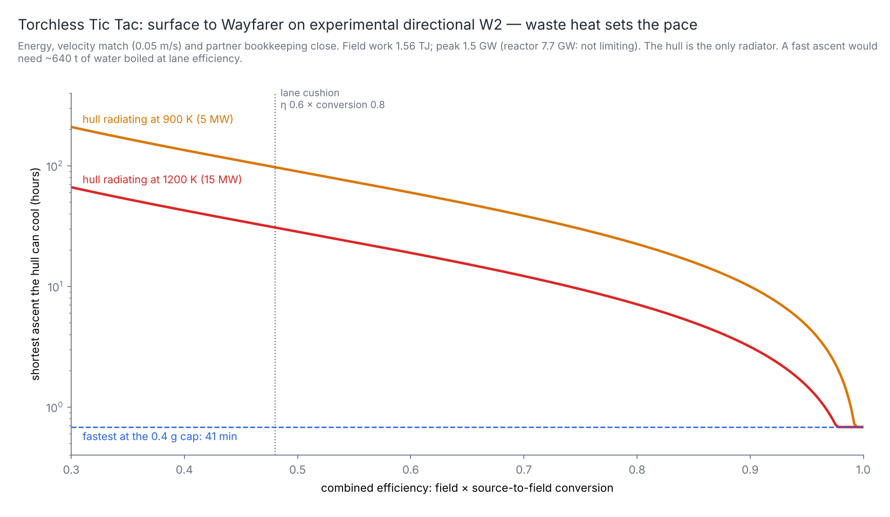

ALL bodies. ALL sponsors. 2026-2226.

# Torchless Tic Tac: Earth to Wayfarer on experimental directional W2

**Granted for this experiment only** (Sol recommendation after b99d437, forwarded by kT): directional W2. This is the lane's existing potential-type field, carried with the vehicle and pointed in any direction, with net acceleration capped at 0.4 g. The partner is UNKNOWN, and every joule is paid onboard. It is NON-CANON and not certified, and its mechanism is unexplained.

**Code:** `directional_w2_ascent.py` → `directional_w2_ascent.json`; `directional_w2_figure.py` → `weave_directional_w2_ascent.png`.

**Set-up:**
- **Vehicle:** 48.5 t. Tic Tac dry mass, 1.1 t payload, 2 t of water kept. The torch's 7 t stays aboard as the reactor; no nozzle saving is credited.
- **Route:** due east from the equator to a circular 200 km orbit (Wayfarer, ASSUMPTION).
- **Earth:** rotating, with an exponential atmosphere; nose-first drag with dynamic pressure capped at 2 kPa.

## What closes

| Item | Result |
|---|---|
| Profile | Climb co-rotating with the air to 200 km, arriving with no vertical speed. Then hold altitude and accelerate east at 0.4 g. **41 min** in total |
| Field work | 1.56 TJ: orbital kinetic energy, plus 0.09 TJ of potential energy, plus 0.3 GJ of drag |
| Velocity match with Wayfarer | 0.05 m/s; altitude error 0. The final metres are closed with the shift, which changes position, not velocity |
| Peak field power | 1.5 GW. The 7.7 GW reactor is **not** the limit |
| Bookkeeping to the partner | 8.9e8 N·s of field impulse, mostly gravity support, and 2.3e15 kg·m²/s of angular momentum. All tallied; the partner is unknown |

## What binds: waste heat

The hull is the only radiator: no radiators may be added, under the restraint rule.

| Radiation from the 153 m² hull | 900 K: 4.5 MW | 1200 K: 14 MW |
|---|---|---|
| **Fast 41-min ascent** | needs combined efficiency ≳ 0.99 | ≳ 0.98 |
| At the lane's figures (0.6 field × 0.8 conversion) | ascent of **3.8 days** (thermal-limited, simulated) | **29 h** (simulated) |
| Water to boil instead, at lane efficiency | ~640 t | ~640 t |

**Why the torch never had this problem:** its propellant carries the reactor's heat out with the exhaust. A propellantless vehicle must radiate all of its losses.

## Load-bearing assumptions for the slow ascent

1. **Holding altitude for a day costs no energy.** This is the lane's static-support assumption: no work is done.
2. **The hull can sit at 900–1200 K for a day or more** while the crew inside stays cool.
3. **The combined efficiency.** The 0.6 field figure is the lane's booked value; the 0.8 conversion is a parameter. Neither is derived.

## Verdict

**The torchless ascent closes in energy, momentum, angular momentum and velocity matching.** Power is not the limit. **Waste heat is**: under the lane's efficiencies she can't reach orbit fast. Two consistent pictures:

- **A slow climb:** about 1–4 days, with the hull glowing at 900–1200 K, held up by the cushion while she builds speed. This needs no new capability beyond directional W2 itself, but it rests on assumptions 1–3.
- **A near-lossless Builder field:** combined efficiency ≥ 0.98. Then the ascent takes 41 minutes and she is cool. This would be a further capability grant.

**Not yet examined:**
- crew habitability for a multi-day climb;
- field failure while suborbital (Earth: blunt-body entry and parachutes; airless bodies: no fallback);
- other bodies (Moon, Mars, Titan);
- time on station before rendezvous with Wayfarer.

## Decision for kT

1. **Keep the torch.**
2. **Accept a slow-climb torchless Tic Tac**, the hot-hull, day-long ascent.
3. **Also grant near-lossless efficiency**, which gives a 41-minute ascent.

The torch stays in the design until you choose.
