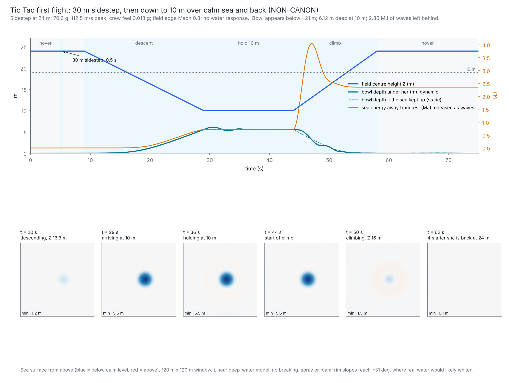

ALL bodies. ALL sponsors. 2026-2226.

# Tic Tac first experimental flight: sortie over calm ocean

**Brief:** Sol, after c6a2282. NON-CANON.
**Rules:** no torch, no Loom hop, no energy budget, no partner rule, no claim of hardware feasibility. This flight exercises only behaviour already modelled: the lane's own cushion water-bowl, sidestep and wall-Mach models, reused unchanged.
**Code:** `first_flight.py` → `first_flight.json`, `first_flight_snaps.npz`; `first_flight_figure.py` → `weave_first_flight.png`.

**Vehicle:** the Tic Tac as built, 69.6 t with a full tank (torch aboard, unused). Field R 15 m with a 2 m wall; W2 cushion on throughout.

## The flight

| Time | Phase | What happened |
|---|---|---|
| 0–5 s | Hover, field centre 24 m | The sea is flat beneath her |
| 5–5.5 s | **30 m sidestep** | Peak 70.6 g and 112.5 m/s. **The crew feel 0.013 g.** The hull takes 2.7 kN. She ends 29.99 m across with a residual speed of 2e-5 m/s. The field edge reaches Mach 0.8, so no boom. The sea does nothing, because she is above the bowl threshold. 0.44 GJ of kinetic energy is borrowed and fully returned |
| 9–29 s | Slow descent to 10 m | A bowl starts below about **21 m** (deeper than 5 cm) and grows as she comes down |
| 29–44 s | Hold at 10 m | The bowl overshoots to **6.1 m** deep, rings, and settles at the static 5.6 m. Rim slopes reach **31°** |
| 44–58 s | Climb back to 24 m | The bowl fills in behind her. Sea energy peaks at 4 MJ as the bowl is let go |
| 58–75 s | Hover | **2.4 MJ of waves** spread outward. The water beneath her is flat again, within 2 cm |

## Notes

- **The crew load is much lower than the test hull's** (0.013 g against 0.66 g). The Tic Tac's 12.8 m hull sits well inside the clean zone, so the field's carriage varies very little across it.
- **The cushion's work on the hull cancels** over descent and climb (9.6 MJ each way).

## Unresolved (reported, not solved)

- **The exchange partner** for every field operation is UNKNOWN; no rule was chosen.
- **The 2.4 MJ of waves** left in the sea is work the field did on the water. Who paid for it is the same open exchange question.
- **The field's local heat** is unknown.
- **Real-sea breaking, spray and foam** at 31° rim slopes are not modelled; the water model is linear. An observer would very likely see whitewater around the bowl's rim.
- **Hardware feasibility:** nothing here establishes it.
