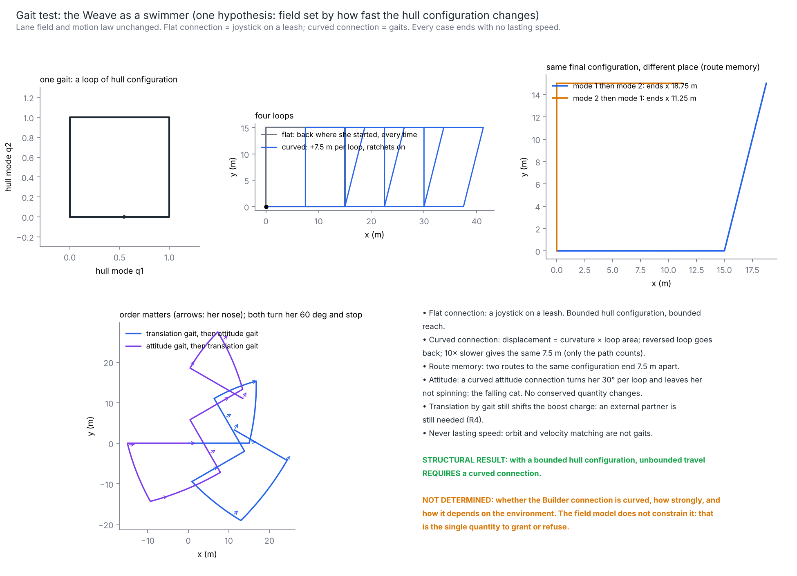

ALL bodies. ALL sponsors. 2026-2226.

# Gait test: is the Weave a swimmer?

**Status:** NON-CANON Builder physics investigation (kT/Sol, 2026-11-22). Canon RF results untouched.
**Code:** `gait_test.py` → `gait_test.json`; `gait_figure.py` → `weave_gait_test.png`.

## One hypothesis

The hull has a **bounded** configuration q = (q1, q2): two hull modes, each in [−1, 1]. The field it generates is set by **how fast that configuration changes**: field-centre velocity V = R(θ)·A(q)·q̇ and rotation rate Ω = A_θ(q)·q̇. This is the swimmer form of Shapere and Wilczek's gauge theory of deformable bodies. A is a connection on configuration space.

Everything else is the lane's existing model, unchanged:
- zero-expansion shift carriage (Natário translation plus a divergence-free rigid rotation);
- the slow-geodesic law, applied to both hull ends;
- R 15 m with a 2 m wall; the Tic Tac hull spans ±6.4 m.

## Results

| Case | Result |
|---|---|
| Flat connection, one square loop | Back exactly where she started |
| Curved translation connection (7.5 m per unit loop area), one loop | **+7.5 m**, with the hull carried |
| Same loop reversed | **−7.5 m** |
| Same loop, 10× slower | **+7.5 m**: only the path counts, not the timing (geometric) |
| Mode 1 then mode 2, versus mode 2 then mode 1 (same final configuration) | Ends at x **18.75 m** versus **11.25 m**: route memory, exactly the enclosed curvature |
| Curved attitude connection, one loop | Turns **30°** and stops turning: the falling cat |
| Translation gait then attitude gait, versus the reverse order | Different final positions, (11.4, 3.3) versus (13.4, 11.0), with the same 60° turn: the operations do not commute |
| 1, 4 and 10 loops | Flat: 0, 0, 0 m. Curved: 7.5, 30 and 75 m |

**In every case she has no lasting speed** (residual w = 0). Gaits change position and attitude, never velocity. That agrees with the lane theorem: orbit and velocity matching are not gaits.

## What this tells us

1. **A structural result (mathematics, not a chosen law):** with a bounded hull configuration, unbounded travel **requires a curved connection**. A flat connection is a joystick on a leash. Our earlier scripted dashes quietly assumed unbounded control.
2. **A curved connection produces distinguishable behaviour** that we did not add by hand:
   - path dependence;
   - insensitivity to timing;
   - reversibility;
   - non-commuting operations;
   - reorientation without spin.

   This is more than control vocabulary (Sol's test).
3. **Turning is free; moving is not.**
   - **Attitude by gait** changes no conserved quantity (angular momentum is zero before and after), so it needs no partner.
   - **Translation by gait** still shifts the boost charge, so an external partner is still needed (R4).
   - Real physics has the same asymmetry: the falling cat can turn in empty space, but translating needs curved spacetime (Wisdom, "swimming in spacetime", 2003).

## Not determined

- **Whether the Builder connection is curved,** how strongly, and how it depends on the environment. The field model does not constrain A.
- This is now the single quantity to grant or refuse, with its consequences already computed.
