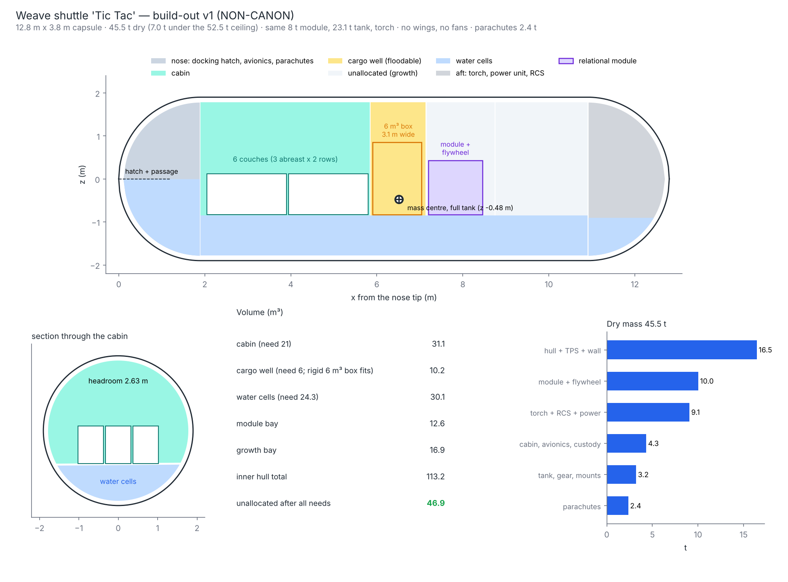
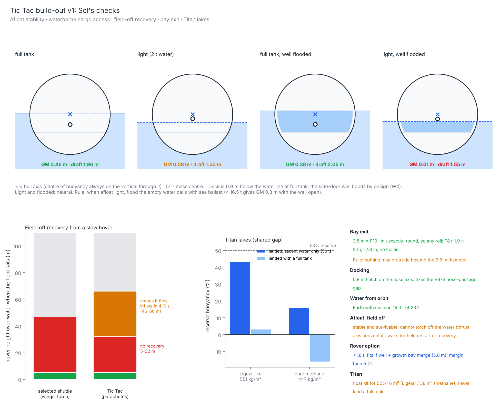

ALL bodies. ALL sponsors. 2026-2226.

# Weave shuttle "Tic Tac": build-out v1

**Decision:** kT, 2026-11-22: "Tic tac. It is." Recorded as `shuttle_weave_tictac_hull_2026_11_22` in kt_decisions. It supersedes the wings/fans/floats fallback and the 22 cm stretch plus collar.
**Status:** NON-CANON lab design. CCR-2026-0005 (PROPOSED) needs a proposal revision: its text names the 13.02 m lifting body and the collar. Its physics scope is unchanged.
**Code:** `tictac_v1.py` → `tictac_v1.json`; `tictac_v1_figures.py` → `weave_tictac_v1_vehicle.png`, `weave_tictac_v1_checks.png`.
**Supersedes:** the earlier test-article sketch, `tictac_test_article.*`, which this commit removes.

## 1. The vehicle (D 3.8 m)

**Mass:** 45.5 t dry, 7.0 t under the 52.5 t ceiling. That includes 2.4 t of parachutes, sized for a full-tank landing.

**Kept from the selected shuttle:**
- the 8 t module with its flywheel;
- the 23.1 t tank;
- the torch;
- cabin, avionics and custody.

**Removed:** wings, lift fans and floats.

**Power:** a 1.0 t unit for cooling and flywheel recharge (ASSUMPTION).

**Layout, fore to aft:**
- **Nose dome:** the docking hatch sits on the axis, with a 0.8 m passage from the very tip. This also fixes the B4-S-family nose-passage gap. Avionics and parachutes share the dome.
- **Cabin:** 31 m³, more than the 21 m³ needed. Six couches, 3 abreast × 2 rows, with 2.63 m headroom.
- **Cargo well:** 10.2 m³, floodable, with a side door in the lower flank (W4). A rigid 6 m³ box fits, 3.1 m wide, against 3.7 m³ in the lifting body.
- **Module bay.**
- **Growth bay.**
- **Aft dome:** torch, power unit and RCS.

**Water:** 30 m³ of cells under a continuous deck at z −0.85 m and in the lower domes. 24.3 m³ is needed.

**Volume margin:** 47 m³ is unallocated after every need is met.

**Climb to orbit with the cushion:** 19.0 t of water from the 23.1 t tank. Torch-only: 21.8 t.

## 2. Sol's checks

| Check | Result |
|---|---|
| **Floating upright** | **Basis:** every section is a circle about the axis, so roll GM = −z_CG exactly, less free-surface effects. **Full tank:** GM 0.46 m, draft 1.96 m. **Full tank, well flooded:** GM 0.38 m. **Light (2 t water):** GM 0.08 m, marginal. **Light, well flooded:** GM 0.01 m, neutral. **Rule:** when afloat light, flood the empty cells with sea ballast. About 16.5 t gives GM 0.3 m with the well open. |
| **Waterborne cargo access** | The deck sits 0.45–1.0 m below the waterline, so the side-door well floods by design and cargo floats in or out. **Rover option:** the B4-S rover kit is +1.8 t (margin then 5.2 t). It fits only if the well and growth bay merge into one 5 m bay. That is kT's choice; decision 6 of 2026-11-20 wanted it. |
| **Field fails in a slow hover** | **Selected shuttle:** no recovery 5–47 m, then the torch. **Tic Tac:** no recovery 5–32 m, then parachutes if they inflate in 2.5 s. With 4–6 s inflation the gap runs to 46–66 m. **Chute assumptions:** a cluster of 17,400 m² CdA, 8 m/s descent at full mass, 1 s mortar deploy. **Torch:** its axis is horizontal, so arresting a fall needs a 90° pitch-up first; no credit is taken. The gap is comparable to the selected shuttle's; it is not worse. |
| **Field off, afloat** | Stable and survivable. It cannot torch off the water because the thrust axis is horizontal, so it waits for a field restart or recovery by Wayfarer. This is the one capability lost against the fan-equipped shuttle. |
| **Bay exit (exact fit)** | **Width:** 3.8 m equals the F10 limit exactly (0.5 m each side, no further margin). **Radius:** r 1.9 ≤ 2.15 (F8). **Length:** 12.8 m (F9). **Roll:** any, because the hull is round. **Collar:** none needed, so Wayfarer is unchanged. **Rule:** nothing may protrude beyond the 3.8 m diameter. D 3.7 gives +0.05 m each side for −6 m³ and less buoyancy. |
| **Titan lakes (shared gap)** | **Landed with ascent water only (50 t):** reserve 43% in Ligeia-like liquid (551 kg/m³) and 16% in near-pure methane (447 kg/m³). **Landed with a full tank:** 3% and −16%, so it would sink in methane. **Rule:** never land on Titan seas with a full tank. **Float kit for a 50% reserve:** 6 m³ (Ligeia) or 38 m³ (methane). The lifting body was worse here. |

## 3. Decisions for kT

1. **Diameter:** 3.8 m with a "no protrusions" rule (recommended: better buoyancy), or 3.7 m for exit margin?
2. **Rover:** bring the rover capsule back by merging the well and growth bay (+1.8 t)?
3. **Field-off afloat:** accept "wait for restart or recovery", with no torch take-off from water?
4. **Titan:** a float kit (and which size), or a no-sea-landing rule above a set tank level?

## 4. Next

- Revise CCR-2026-0005: hull text, collar withdrawn.
- Update the operating card for the Tic Tac.
- Model geometry for review. The released GLBs are not touched until kT signs off.
