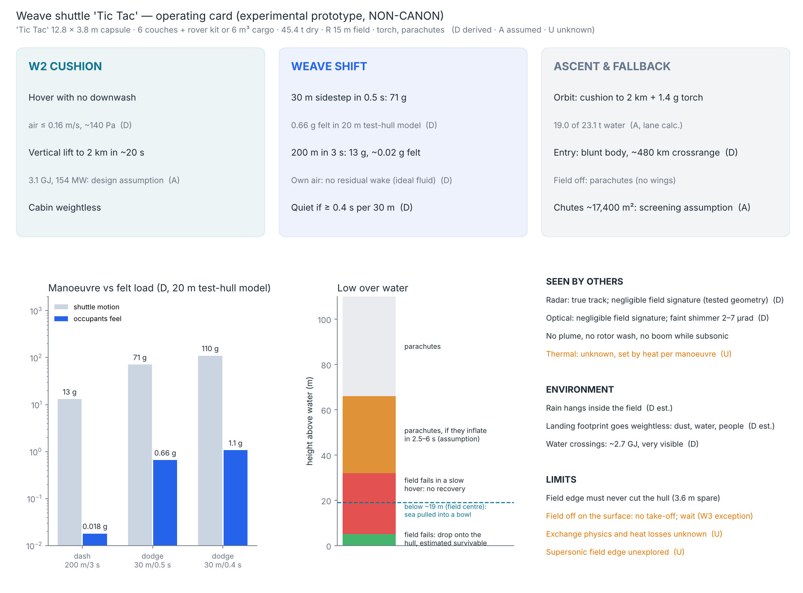

# Weave shuttle "Tic Tac": operating card

ALL bodies. ALL sponsors. 2026-2226.

**Status:** experimental prototype, **NON-CANON** until CCR-2026-0005 is approved by kT. Rewritten for the Tic Tac hull (kT 2026-11-22, Sol rulings on 5062961). The previous lifting-body card is in Git history.

**Labels:**
- **D** = DERIVED in this lane's models (cited);
- **A** = operating or design ASSUMPTION;
- **U** = UNKNOWN (research mystery).

Numbers are for the Tic Tac unless marked "test hull" (the 20 m outing hull).

## The vehicle

A smooth, warm-white capsule, 12.8 m long and 3.8 m across. Nothing is visible on the outside but a flush nose docking hatch and a flush side door.

| Item | Value |
|---|---|
| Crew and cargo | Six couches in a 31 m³ cabin. A combined bay takes either the removable rover kit (+1.8 t) or 6 m³ of cargo |
| **W2 cushion** | Cancels gravity inside its field: weightless cabin, powered hover, vertical lift |
| **Weave shift** | Carries the whole vehicle, its air included, through space; very high coordinate acceleration with modest occupant loading |
| **Torch** | 7.7 GW, for the climb to orbit above the cushion |
| Field | R 15 m sphere, 2 m wall. The whole vehicle stays within 6.4 m of centre, 3.6 m inside the clean zone (D) |
| Mass | 45.4 t dry: 8 t relational module, 1 t installation, 1.0 t flywheel, 2.4 t parachutes. 23.1 t tank |
| Docking | 0.8 m hatch on the nose axis. Fits the Wayfarer bay at 12.8 m with no collar. Nothing may protrude beyond 3.8 m |
| Space | 47 m³ left empty on purpose |

## What it can do

**1. Lift off vertically with no downwash** (W2 cushion)
- **Hover in air:** air speed ≤ 0.16 m/s and a pressure shift of ~140 Pa; nothing is blown around (D, linear compressible air).
- **Vertical lift to 2 km in ~20 s:** ~3.1 GJ from the flywheel at up to 154 MW. Height is paid for. This is a prototype design assumption, not proven hardware (A).
- The cabin is weightless throughout cushion flight.

**2. Move like nothing else** (Weave shift)

| Manoeuvre | Peak | Felt by occupants |
|---|---|---|
| 200 m dash in 3 s | 125 m/s, 13 g | ~0.02 g (D, test hull) |
| 30 m sidestep in 0.5 s | 112 m/s, 71 g | ~0.66 g in the 20 m test-hull model, not a guarantee for this hull (D, test hull). For the Tic Tac the field-carriage differential is ≤ 0.08% at the hull ends, against 0.8% at the old wing tips (D, closure model) |
| 30 m sidestep in 0.4 s | 110 g | ~1 g (D, test hull) |

- **Quiet in calm air (ideal-fluid model):** the vehicle carries its own pocket of air, with no airflow over the hull, no compression and no residual wake (D). Real-atmosphere silence is not claimed.
- **Quiet limit:** the field edge stays subsonic while peak speed is below ~140 m/s, i.e. ≥ 0.4 s per 30 m (D).

**3. Reach orbit, enter, float**
- **Orbit:** cushion lift to 2 km, then a 1.4 g torch climb. Earth needs 19.0 t of the 23.1 t tank (20.6 t with the rover). This is a prototype design assumption supported by the lane calculations (A).
- **Entry:** as a blunt body, about 480 km crossrange, ~2.8 g, ~126 W/cm² peak (D, Newtonian screen).
- **Floats on its own hull:** 93% reserve at full load (D). GM 0.46 m with a full tank.
- **Rover from the water:** only a rover-sized wet dock (3.4 × 2.1 m) beside the side door floods; the rover floats in and out. **Rule:** when light, take on 12–13 t of sea ballast before opening the dock (GM 0.3 m). It is an operating requirement, not a demonstrated procedure (A).

**4. Work in weather, on the ground and on the water**

| Setting | Behaviour |
|---|---|
| Wind 10–15 m/s | Blows straight through the field; only the hull feels it; crew 0.008–0.018 g (A, hull area) |
| Rain | Stops falling inside the field: drops halt within ~1 m and drift through with the wind; dry patch under the craft (D, estimate) |
| Landing on ground | Inside the footprint, loose ground, puddles **and people** go weightless; dust lifts with any breeze; the field edge presses the surface down by up to ~3.3 g in a ring (D, estimate). Ground crew stay outside 15–19 m |
| Hover over calm water | Pulls the sea into a bowl beneath the craft: 5.6 m deep and ~35 m across with the field centre 10 m up; nothing above ~19 m (D, static). Forms in ~1–2 s; after a jink the old pit rebounds while a new one opens (D, coarse estimate) |
| Skim | Clean above ~19 m (field centre). Lower skims plough the sea (74 MJ at 10 m) (D, kinematic) |
| Water exit / entry | Leaves the sea inside a ball of seawater (~8.9 kt on the test geometry; release ≈ 2.3 GJ splash); dives inside a ball of air. Violent, visible, ~2.7 GJ per crossing (D, kinematic) |
| Titan seas | Tank-level rule and an optional flotation kit. A full tank sinks in near-pure methane. Sea landings stay restricted until equipped |

## Transitions

- **Cushion → torch:** above the cushion ceiling (~2 km in this profile), the torch climbs at 1.4 g (D).
- **Shift + cushion:** run together near a planet. The cushion holds the vehicle up and the shift moves it. The shift alone cannot hover for long: ~14 s before the field edge goes supersonic (D).
- **Field off on the surface, land or water:** **no take-off.** The torch axis is horizontal, so the vehicle waits for a field restart or Wayfarer recovery. **W3 is recorded as an EXCEPTION, not a pass.**

## How it looks to others (sensor signature)

| Sensor | Signature |
|---|---|
| Radar | Sees the hull's true track and speed (Doppler ray-traced through the field); negligible direct field signature in the tested head-on geometry (D) |
| Optical | Negligible direct field signature in the tested side-on geometry: light bent ≤ 2e-12 rad (D). The optical trace found is faint shimmer from moved layered air, 1.7–6.5 µrad: below the eye, within reach of schlieren instruments (D). Other angles and speeds untested |
| Overall | A smooth white object doing 71–110 g, with no plume, no rotor wash, no wings and no visible engines; no field-edge sonic boom while the edge is subsonic (models above). Water operations are highly visible |
| Thermal | **U**: depends on how much of each manoeuvre's borrowed energy (~0.5 GJ per sidestep) is lost as heat |

## Limits worth knowing

**Field failure** (estimates; no magic failsafe):

| Situation | Outcome |
|---|---|
| Slow hover ≤ 5 m over water | Drops onto its own hull: estimated survivable at 10 m/s impact (A) |
| Slow hover ≤ ~2 m over land | Drops onto its gear: estimated survivable at 6 m/s (A) |
| Slow hover 5–32 m | **No recovery.** Experimental limit: such hovers are flown knowingly |
| Above 32 m (2.5 s inflation; 46–66 m if inflation takes 4–6 s) | Parachutes. **Screening assumption:** ~17,400 m² of effective drag area (about a dozen 50 m canopies), not a demonstrated capability (A) |
| In forward flight | Parachutes (drogue first); no glide, no wings |
| Afloat | Stable; waits for restart or recovery |

**Design rule (D):** the field edge must never cut the hull. The Tic Tac stays 3.6 m inside the clean zone.

**Unknowns (U):**
- the energy–momentum exchange (conservation retained);
- heat per manoeuvre;
- behaviour with the field edge supersonic;
- real-sea breaking and foam;
- non-symmetric gusts.

## Sources (lane reports, `weave/` and `weave_final/`)

| Topic | Report |
|---|---|
| Cushion in air, landing, lapse correction | `WEAVE_OUTINGS_2026_11_22.md` §3, `outing_landing.py` |
| Dodge, sensors, transmedium | `WEAVE_OUTINGS_2026_11_22.md` §1, §2, §4 |
| Water bowl and its dynamics | `WEAVE_NIMITZ_VIEW_2026_11_22.md` §1, §5 (physics only) |
| Ideal-fluid transport, gusts | `WEAVE_SHIFT_FLUID_2026_11_21.md`, `WEAVE_SHIFT_GUST_2026_11_21.md` |
| Tic Tac mass, layout, hydrostatics, fallback, Titan | `TICTAC_BUILDOUT_V1_2026_11_22.md`, `tictac_v1.py` |
| Tic Tac vs lifting body | `tictac_vs_shuttle.py`, `weave_tictac_vs_shuttle.png` |
| Exchange physics status | `WEAVE_SOURCE_CLOSURE_2026_11_22.md` §6 (prototype disposition) |
