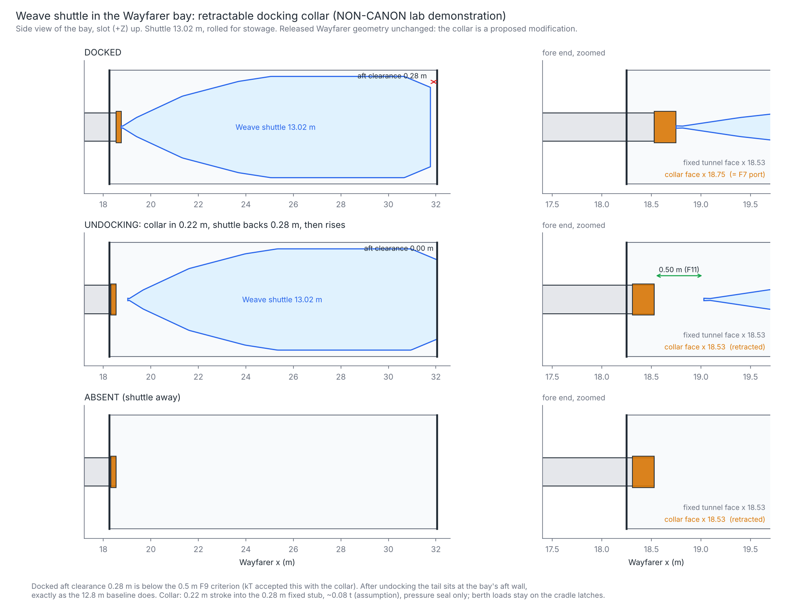
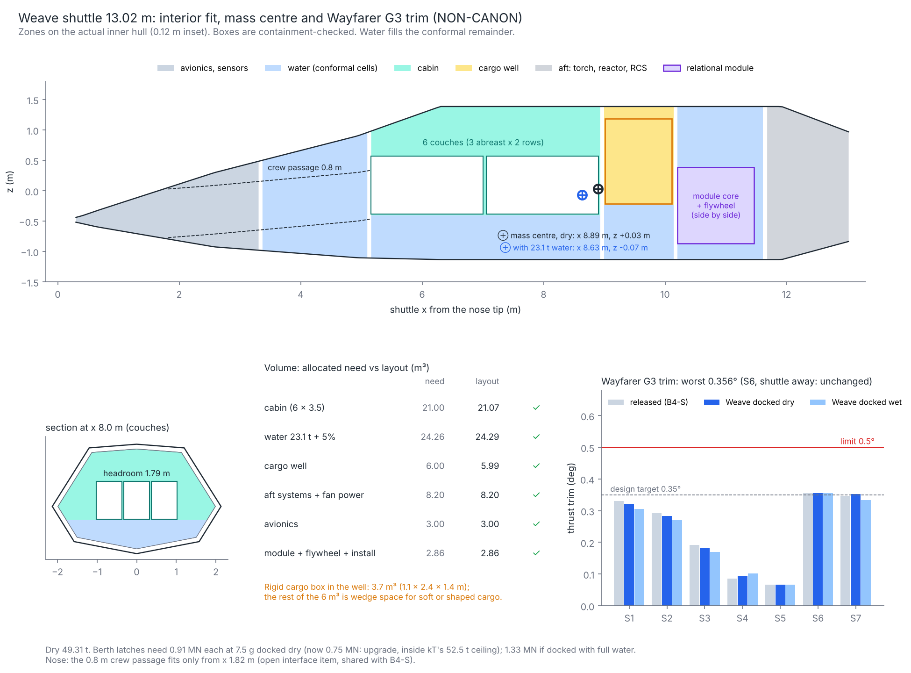

ALL bodies. ALL sponsors. 2026-2226.

# Weave shuttle, step 5: geometry, docking collar, interior fit and G3 trim

**Status:** NON-CANON lab demonstration. CCR-2026-0005 is PROPOSED (PR #570, main `5daacc7f`). No released Wayfarer geometry, canon GLB or `canon_glb.json` is touched. The collar is a proposed modification.
**Code:** `step5_geometry.py` → `step5_geometry.json`; `step5_figures.py` → `weave_step5_collar.png`, `weave_step5_interior.png`.

## 1. Result

The 13.02 m shuttle closes physically.
- **Bay:** it fits, with the collar demonstrated in its docked, undocking and absent states.
- **Interior:** the full layout fits inside the real hull, not just as a volume sum.
- **Wayfarer:** worst G3 trim is unchanged.

There are three open items (§6).

**Recommended final length: 13.02 m** (stretch 0.22 m, module at 4 t/m³). It needs kT's confirmation.

| | 13.02 m | 13.12 m |
|---|---|---|
| Dry / margin to 52.5 t | 49.32 / 3.18 t | 49.45 / 3.05 t |
| Interior residual (volume sum) | +0.04 m³ | +0.84 m³ |
| Water margin in the layout | +0.03 m³ | +0.83 m³ |
| Docked aft clearance (F9 criterion 0.5 m) | 0.28 m | 0.18 m |
| Collar stroke / fixed stub left in the bay | 0.22 / 0.28 m: nests | 0.32 / 0.18 m: does **not** nest; it would have to slide back through the bulkhead |
| Climb water, buoyancy, field-off touchdown | 22.6 of 23.1 t; 110.5 ≥ 107.6 m³; 50 m/s at 4.5% uplift | 22.7 t; 111.4 ≥ 107.8 m³; 50 m/s at 4.3% |
| Bay fit r, slot half-width, field max radius | 2.13 ≤ 2.15; 1.56 ≤ 1.9; 8.55 ≤ 10 m | same |

13.12 m buys 0.8 m³ of volume but loses 0.10 m of docked clearance and breaks the simple collar nesting. **13.02 m closes with no spare volume:** water margin +0.03 m³.

## 2. Docking collar (proposed Wayfarer modification)

**What it is:** Wayfarer's `tunnel_2` (r 0.6 m, x 17.6–18.75) ends in a telescoping sleeve.
- **Stroke:** 0.22 m into the fixed stub, which now ends at x 18.53.
- **Mass:** ~0.08 t (ASSUMPTION).
- **Load path:** pressure seal only. Berth loads stay on the four cradle latches.

| State | Collar face | Shuttle nose → tail | Aft clearance |
|---|---|---|---|
| DOCKED | 18.75 (the F7 port, unchanged) | 18.75 → 31.77 | 0.28 m (below the 0.5 m F9 criterion: kT accepted this with the collar) |
| UNDOCKING | 18.53 (retracted) | 19.03 → 32.05 (backs off 0.28 m) | 0.00 m, the same as the 12.8 m baseline after its 0.5 m back-off |
| ABSENT | 18.53 (retracted) | none | none |

**F11:** the separation is 0.22 m of retraction plus 0.28 m of back-off, 0.50 m in total. Then the shuttle rises through the slot rolled 86°, exactly as before.

## 3. Interior fit (13.02 m)

The zones run fore to aft along the real inner hull (0.12 m inset):

| Zone | x (m) | Contents | Check |
|---|---|---|---|
| Nose | 0–3.36 | avionics and sensors, 3.00 m³ | volume |
| Forward tank | 3.36–5.14 | water cells around the 0.8 m crew passage | volume |
| Cabin | 5.14–8.96, floor z −0.40 | 21.07 m³; six couches 3 abreast × 2 rows | each couch box contained; headroom 1.79 m |
| Cargo well | 8.96–10.16, floor z −0.23 | 6.0 m³ gross | largest rigid box **3.7 m³** (1.1 × 2.4 × 1.4 m) |
| Module bay | 10.16–11.67 | 8 t core cube (2.0 m³) and flywheel drum side by side on floor z −0.87; remainder water | both boxes contained |
| Aft | 11.67–13.02 | torch, reactor, RCS, fan power train, 8.20 m³ | volume |

**Water:** 24.29 m³ in conformal cells, against 24.26 needed (23.1 t plus 5% ullage).

**Mass centre:**
- dry 49.31 t: x 8.89 m from the nose tip, z +0.03 m;
- with 23.1 t of water: x 8.63 m, z −0.07 m.

These positions are ASSUMPTIONS:
- wing root 5.5–7.3 m;
- fans/reactor mass split half at the wing roots and half aft;
- shell mass distributed by section perimeter.

## 4. Wayfarer G3 trim

**Method:** a perturbation of the released v0.5 states. The B4-S part (36.48 t at its source centroid) is replaced by the Weave shuttle in the docked states, and the collar is added in all states. Trim follows `build_v05.trim_deg`, with the pinned torch-chain offset (y +0.03, z −0.26). Both roll senses are checked.

**Worst trim:** 0.356°, state S6 (full, shuttle away). It is identical to the released value: the shuttle is not aboard. The limit is 0.5°.

**Docked states:** the heavier shuttle sits near the axis, so:
- S1–S3 improve by 0.01–0.03°;
- S4 rises to 0.10° and S7 reaches 0.353° (roll −). Both are inside the limit; S7 is just above the 0.35° design target, where the released S6 already sits.

A full `build_v05`/`certify` G3 run belongs to the implementation step after approval.

## 5. Berth latches

At 7.5 g ultimate load, docked dry, each latch needs **0.91 MN** against 0.75 MN today. That upgrade sits inside kT's 52.5 t docked-dry ceiling (decision 2026-11-20 #3, "berth latch upgrade included"). Docked with full water, each latch would need 1.33 MN.

**Recommendation:** dock dry under thrust. This matches the Wayfarer states, which carry the shuttle dry.

## 6. Open items (not solved here)

1. **Crew passage through the nose.** The nose port is at the nose tip (F7), but an 0.8 m passage first fits inside the hull at x 1.82 m. The B4-S-family base hull has the same gap (1.94 m), so this is a pre-existing interface question about how the nose hatch reaches the cabin. It needs a decision (nose tunnel fairing, opening nose cap, or another hatch arrangement) before the collar interface is detailed.
2. **Cargo well shape.** The 6 m³ is a gross allocation. A rigid box of 3.7 m³ fits; the rest is wedge space.
3. **No spare volume at 13.02 m** (+0.03 m³). Any outfit growth needs 13.12 m (and a re-designed collar nesting) or a utility trade.

## 7. Decisions for kT

1. Final length: **13.02 m** (recommended) or 13.12 m?
2. Accept the collar design as demonstrated (0.22 m stroke, docked aft clearance 0.28 m) for the Wayfarer engineering change request?
3. Berth: latches to ≥ 0.91 MN with a dock-dry rule under thrust?
4. Nose crew passage: which approach should Sol detail?
