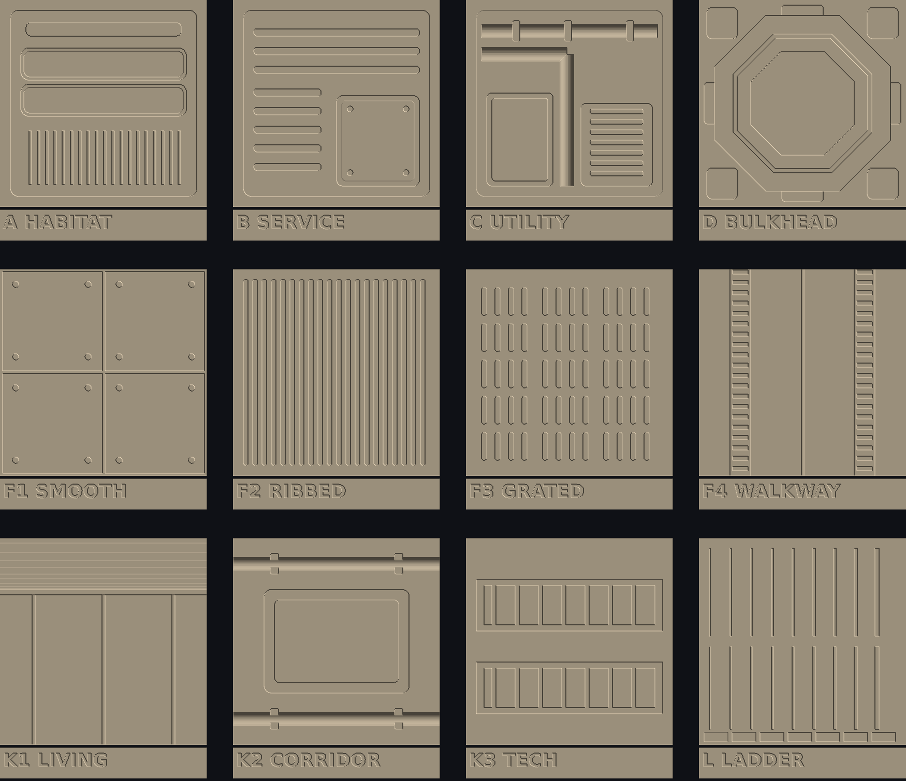

# Wayfarer 1:25 surface test sheet (walls, floors, ceilings)
**ALL bodies. ALL sponsors. 2026-2226.**

**Status:** test print requested by kT (13 Nov 2026). This is print tooling only; it changes no geometry, mass or canon. Claude designed it from kT's reference sheet ("Organic Japandi × Nostromo"), adapted to an FDM printer.

**Printer:** Bambu Lab A2L, FDM. It ships with a 0.4 mm nozzle and also takes 0.2, 0.6 and 0.8 mm nozzles; layer height is 0.08–0.28 mm.

## Print settings
| Setting | Value |
|---|---|
| File | `wayfarer_1to25_surface_test_sheet.stl` (175 × 151 mm, one plate, 12 separate tiles, mm units) |
| Orientation | Flat, **detail face up**, exactly as exported. Do not rotate onto an edge |
| Nozzle | Print the whole sheet with the stock **0.4 mm** nozzle first. If a 0.2 mm nozzle is bought, print it again with that |
| Layer height | **0.08 mm** (relief depths are multiples of 0.04 mm) |
| Material | PLA, matte light colour, so the relief reads in raking light |
| Top surface | Turn **ironing** on for the top surfaces if available; it helps the smooth decks and panels |
| Supports | None needed |

## Tiles (each 40 × 40 mm = 1 × 1 m real, base 1.6 mm)
| Code | Type | Smallest feature | Where it goes on Wayfarer |
|---|---|---|---|
| A | Habitation wall: lining, light-strip reveal, padded panels, slatted panel | 0.5 mm grooves | Cabins, wardroom, observation, wellness shelter |
| B | Service wall: routing ribs, access panel, fasteners | 1.1 mm fasteners, 1.4 mm ribs | Corridors, galley, washrooms, medical |
| C | Utility wall: two pipes with clamps, service panel, louvre box | 0.9 mm louvres | Life support, workshop, stores, airlock |
| D | Bulkhead frame: octagonal sealing frame, gussets | 0.8 mm steps | Round pressure hatches, airlock, vault, shelter door |
| F1 | Smooth deck: panel seams, fasteners | 0.5 mm seams, 1.2 mm fasteners | Cabins, wardroom, shelter, medical |
| F2 | Ribbed deck | 0.9 mm ribs and gaps | Airlock, suit room, washrooms, galley wet zone |
| F3 | Grated deck | 1.0 × 5.4 mm slots, 0.8 deep | Life support, workshop, stores |
| F4 | Inlaid walkway: recessed wear strips with tread bars | 0.8 mm bars | Corridor rings to the ladders |
| K1 | Living ceiling: cove sweep, light reveal, radial seams | 0.6 mm seams | Living spaces |
| K2 | Corridor ceiling: recessed light panel, overhead rails | 2.4 mm rails | Corridors |
| K3 | Tech ceiling: cable trays with rungs | 0.8 mm rungs | Life support, workshop |
| L | **Detail ladder**, the calibration tile | see below | Sets the final rule |

## Reading tile L
- **Top half:** raised lines. **Bottom half:** grooves.
- Line widths, left to right: **0.20, 0.25, 0.30, 0.35, 0.40, 0.45, 0.50, 0.60, 0.80 mm**.
- **Along the bottom edge:** relief steps of **0.08, 0.12, 0.16, 0.24, 0.32, 0.48, 0.64 mm**.
- The narrowest raised line and the narrowest groove that print cleanly set the minimum for all the deck linings.
- The expected limit is about 0.45 mm raised and 0.5 mm groove on the 0.4 nozzle, and about 0.25 / 0.3 mm on the 0.2 nozzle.

## What to report back
1. A raking-light photo of each tile.
2. The narrowest clean raised line and groove on tile L.
3. Any tile where detail closed up or blurred: F3 slots, C louvres and A slat grooves are the most likely.

**Source:** `testsheet.py` builds a 0.05 mm heightmap and meshes it into one closed STL. Mesh volume equals heightmap volume (36,285 mm³).

**Next:** once the rule is set, apply the surface types deck by deck. Linings are paid from `outfit_L*`, so no new mass.
